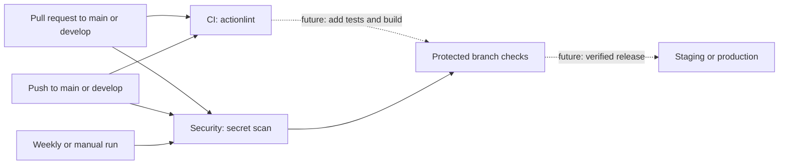

# DevOps guide

## Current state

The repository has a README and MIT license but no application, dependency manifests, lockfiles, tests, build commands, database, containers, infrastructure, or deployment target. `main` is the only existing branch. The workflows are a starting point, not a production deployment system: a green check currently says only that workflow lint and secret scanning passed. It does not establish application quality or deployability.

## Architecture and execution



- **CI / Workflow lint** checks GitHub Actions files with actionlint. The downloaded Linux binary is versioned and checksum verified; checkout is pinned to a commit. There is no package cache because there are no package dependencies.
- **Security / Secret scan** uses Gitleaks on push, pull requests, weekly, and manual dispatch. It scans the event-specific commit range (and history on scheduled or manual runs) and fails on findings. The action and checkout are pinned. Fork PRs use the ordinary `pull_request` event with read-only token permissions and no deployment credentials.
- Concurrent runs for the same PR or branch are cancelled when a newer run starts. Separate push and PR runs can occur when directly pushing a protected branch that is also the source of a PR; ordinary fork feature branches do not trigger the push workflows.
- GitHub Actions logs and check statuses provide failure visibility. Configure GitHub notification preferences and watch the repository to receive notifications; no external notification integration is configured.

## Branching and protection

Use `main` for production, `develop` for integration, and `feature/*`, `fix/*`, and `hotfix/*` in contributor forks. Open pull requests into `develop` or `main`; promote tested changes to `main` through a PR. These names are a convention, not enforcement by these files.

Repository administrators should:

1. Create `develop` from the appropriate `main` commit and enable GitHub Actions.
2. Create branch rules or rulesets for `main` and `develop`: require pull requests, review as appropriate, and require the **Workflow lint** and **Secret scan** status checks. Select the actual check names after the first successful runs. Require branches to be up to date if desired; restrict direct pushes and bypasses according to team policy.
3. Review fork workflow approval settings. Fork PRs do not receive repository secrets. Do not use `pull_request_target` to run untrusted PR code.
4. Enable GitHub's dependency graph, Dependabot alerts, and secret scanning where available for the repository and plan. These settings are not configured by this repository.

Branch protection is configured on GitHub, not enforced by the workflows alone. Check availability of rulesets, required reviews, environments, and scanning features for the repository's visibility and GitHub plan.

## Secrets and environment configuration

No user-provided secrets are currently required for a personal repository. GitHub supplies `GITHUB_TOKEN` automatically with read-only contents permission. Gitleaks' action requires a `GITLEAKS_LICENSE` secret for organization-owned repositories; see the [action documentation](https://github.com/gitleaks/gitleaks-action). Confirm fork PR behavior before moving the repository to an organization, since GitHub does not pass repository secrets to fork PRs. Never add a secret merely to make a fork PR scan pass or switch to privileged execution of fork code.

No application environment variables, GitHub environments, credentials, or deployment secrets have been defined. When a real host is selected, store credentials as environment-scoped GitHub Secrets, use separate staging and production identities with least privilege, and document every required secret and non-secret variable by its actual name. Do not commit `.env` files or credentials.

## Local verification

Install [actionlint](https://github.com/rhysd/actionlint) and [Gitleaks](https://github.com/gitleaks/gitleaks) from their official releases, then run from the repository root:

```sh
actionlint -color
gitleaks git --redact .
```

The second command scans locally available Git history, which may differ from a PR's scan range. Neither command runs application tests or a build because none exist. Gitleaks may identify a candidate secret: rotate/revoke exposed credentials immediately, even if the finding is later removed from the current tree. Inspect findings securely and use narrowly scoped exceptions only after review.

## Adding application CI

When source code is added, choose the runtime and package manager actually used, commit the lockfile, and add jobs to `ci.yml` for clean dependency installation, lint, formatting, static analysis and types where applicable, unit and relevant integration/API tests, and a production build. Use the project's real commands and publish test reports even when tests fail, without masking failures. Add service containers only for real integration dependencies. Cache package downloads keyed by the lockfile and runtime, not secrets or built releases. Add dependency vulnerability scanning and language-appropriate code security analysis, and require all critical checks in branch protection before deploying.

## Deployment, health checks and recovery

**Deployment is not configured.** Neither branch deploys, and no production or staging workflow is active. Select the actual host, build artifact, credentials, health endpoint, migration tooling, and release strategy before adding deployment automation. There is no working rollback yet.

To implement it safely:

1. Add staging and production GitHub environments and the host-specific secrets, protection rules, and URLs; configure staging only if a staging target exists. Document names and access requirements.
2. Build an immutable artifact identified by the commit SHA. Gate deployment on successful CI **and** security checks for that exact commit; avoid deploying PR artifacts or stale runs. For manual production deployment, verify the selected SHA passed the same checks and belongs to the approved `main` history. Ensure deployment workflows cannot run untrusted fork code with credentials.
3. Serialize deployments per environment without cancelling an in-progress deployment. Deploy the verified artifact using the host's supported mechanism, record the release identifier and logs, and verify a real health endpoint with a timeout and retries. Fail the job and notify the team if deployment or verification fails. GitHub environment approvals can add a production gate where supported.
4. Define and test a host-specific rollback that restores a retained known-good artifact and verifies its health. Until then, rollback requires an operator to restore a previous known-good release using the host's documented procedure; no command is available in this repository.
5. Before database migrations, take and test backups, assess compatibility with both old and new application versions, and prefer expand/contract migrations. Document recovery and whether a release can safely be rolled back after migration. Never automatically reverse an unknown or destructive migration.

Add Docker only if the chosen runtime or host requires it; if added, use a minimal multi-stage image, a non-root user where supported, persistent database storage, and application-aware health and startup checks.

## Troubleshooting

- **Workflow lint fails:** run `actionlint -color` locally and fix the reported workflow location. If download or checksum verification fails, check release availability and the pinned checksum; do not disable verification.
- **Secret scan fails:** inspect the protected Actions logs, rotate any exposed credentials, remove the secret from future use, and consider history cleanup. History rewriting alone does not revoke a credential. Gitleaks may report false positives; review its documented allowlist mechanisms.
- **Required check is missing:** confirm the PR targets `main` or `develop`, Actions are enabled, the workflow exists on the relevant branch, and the ruleset uses the actual job check name. New fork PRs may need maintainer approval.
- **A planned deployment cannot start:** no deployment workflow or target exists yet. Follow the deployment setup above after selecting infrastructure; do not add placeholder credentials or infer a working release from a green baseline check.
