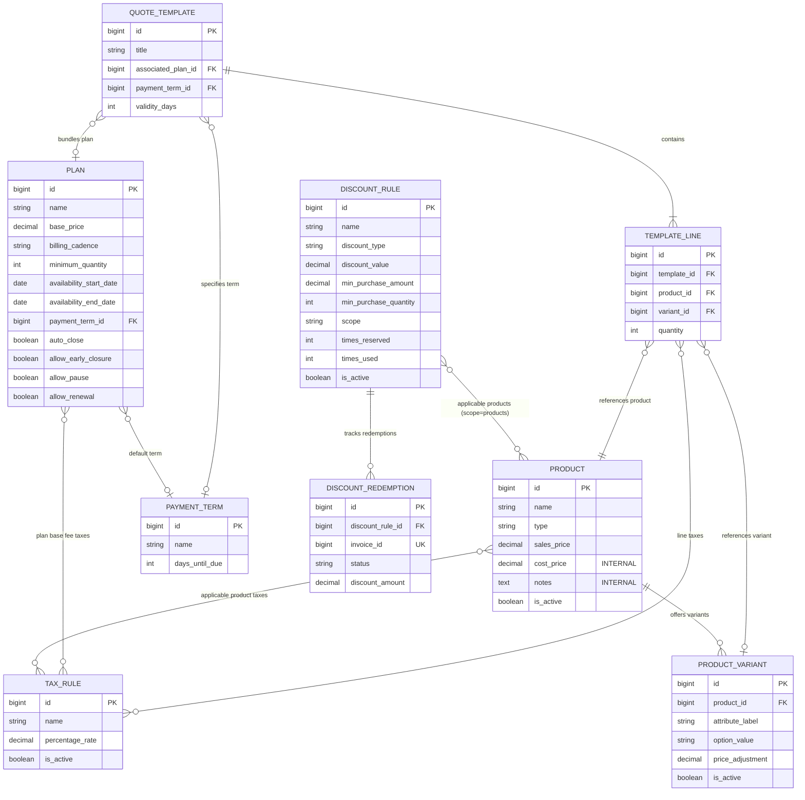
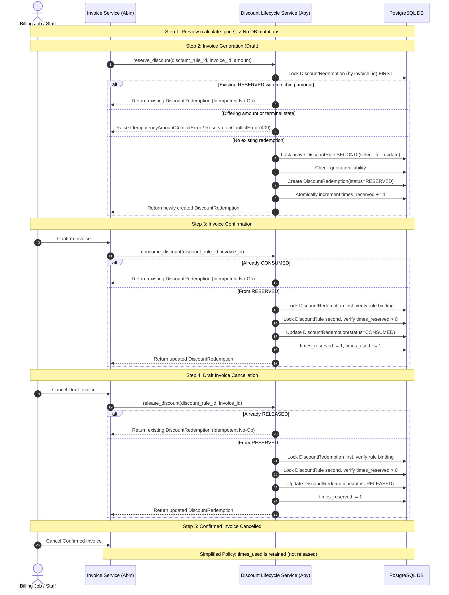

# Architecture & Data Contract: Catalog & Authoritative Pricing Engine

| Metadata | Value |
| :--- | :--- |
| **Document Version** | 2.5.0 (Hour 1 Contract Freeze – Final Technical Corrections) |
| **Project** | Subscription Management System (Brightloop Software) |
| **Phase / Milestone** | Hour 1 – Catalog and Pricing Model Contract |
| **Author** | Aby John (Catalog, Plans, Taxes, Discounts, Payment Terms, Templates & Pricing Engine) |
| **Target Tech Stack** | Python, Django 4.2.30, Django REST Framework 3.16.1, PostgreSQL, Celery 5.5.3, Redis 5.2.1 |
| **Authority** | Brightloop Software Problem Statement & 18-Hour Hackathon Delivery Plan |
| **Status** | Contract Freeze Pending Team Alignment on Open Decisions (Hour 1) |

---

## 1. Executive Summary & Domain Scope

Brightloop Software sells subscription software, recurring add-ons, and physical or service items across flexible cadences (daily, weekly, monthly, yearly). To eliminate manual typing, billing errors, and spreadsheet synchronization drift, this contract formalizes:

1. **Catalog Domain Models:** Standard products, variant pricing, subscription plans, commercial payment terms, additive tax rules, discount rules, discount redemptions, and quotation templates.
2. **Quotation as a Stage of Subscription Workflow:** In alignment with Brightloop business operations, a quotation is a lifecycle stage of the core `Subscription` entity (`Draft` $\rightarrow$ `Quotation` $\rightarrow$ `Confirmed` $\rightarrow$ `Active` $\rightarrow$ `Closed`), not an independent database architecture or separate editor.
3. **Pure Pricing Engine vs. Database Eligibility Service:** Strict architectural separation between database-backed discount eligibility querying (`DiscountEligibilityService`) and the pure, deterministic pricing calculation engine (`calculate_price`).
4. **Enforced Single Redemption Per Invoice:** Dedicated `DiscountRedemption` model enforcing a unique constraint on `invoice_id` alone, guaranteeing that an invoice applies at most one discount and preventing duplicate reservations.
5. **Reservation Idempotency & Amount Verification:** In `reserve_discount()`, retries on existing reservations strictly compare the requested `discount_amount` against the persisted `redemption.discount_amount`. Differing amounts raise an `IdempotencyAmountConflictError` (HTTP 409) rather than silently overwriting persisted financial data. Retries remain valid even if the underlying discount rule is deactivated after initial reservation.
6. **Consistent Lock Hierarchy (Deadlock Prevention):** Across `reserve_discount()`, `consume_discount()`, and `release_discount()`, locks are strictly acquired in the same order: **`DiscountRedemption` (by `invoice_id`) first, then `DiscountRule` (by `discount_rule_id`) second**.
7. **Explicit HTTP 409 Exception Mapping:** Reservation conflicts and unique-constraint races are cleanly mapped to HTTP 409 at the invoice generation layer, ensuring that aborted PostgreSQL transactions roll back completely before returning error responses.
8. **Consistent Lifecycle Return Contracts:** All discount lifecycle service methods (`reserve_discount`, `consume_discount`, `release_discount`) consistently return the affected `DiscountRedemption` model instance.
9. **Discount Limits & Defensive Capping:** Percentage discounts are strictly bounded ($0 < \text{discount\_value} \le 100$). Fixed discounts must be positive and are defensively capped at the eligible gross subtotal by the pricing engine.
10. **Non-Negative Effective Variant Prices:** Negative variant adjustments are permitted only when the resulting effective unit price ($\text{sales\_price} + \text{price\_adjustment}$) is $\ge \text{Decimal('0.00')}$.
11. **Additive Multi-Tax Architecture & Override Semantics:** Multiple additive percentage taxes supported via Many-to-Many associations on products and plans. Empty template line tax selections inherit parent product taxes, while non-empty selections override them.
12. **Explicit Serializer/Service Date Range Validation:** Both `Plan` and `DiscountRule` enforce start date $\le$ end date validation in DRF serializers and service methods, rather than relying solely on `Model.clean()`.
13. **No-Proration Policy:** Rejection of partial final billing cycles and fractional proration in the MVP to guarantee financial simplicity and auditability.
14. **Commercial Arithmetic Standard:** Strict adherence to Python `Decimal` and `ROUND_HALF_UP` (standard commercial rounding) to two decimal places.

---

## 2. Django Application Structure & Model Ownership

In accordance with the hackathon backend specification, Aby's domain spans three functional areas: **`catalog`**, **`pricing`**, and **`templates`**.

The table below outlines proposed model ownership within these three areas, the corresponding app placement in the repository, and cross-app coordination points requiring Team Lead (Rijin) approval:

| Hackathon Area | Owning Django App | Models / Services | Cross-App Dependencies & Team Approval Points |
| :--- | :--- | :--- | :--- |
| **`catalog`** | `products` | `Product`, `ProductVariant` | Referenced by `subscriptions` (Abin) for order lines and `portal` (Adhi) for catalog browsing. |
| **`catalog`** | `plans` | `Plan`, `PaymentTerm` | `Plan` is referenced by `subscriptions.Subscription`; `PaymentTerm` governs invoice due dates in `billing`. |
| **`pricing`** | `products` *(or `billing`)* | `TaxRule` | Referenced by products and subscription plan base fees; applied in invoice line calculations. |
| **`pricing`** | `discounts` | `DiscountRule`, `DiscountRedemption`, `DiscountEligibilityService`, `DiscountLifecycleService` | Admin-only configuration; `DiscountLifecycleService` reservation/release hooks are invoked inside `billing` transactions (Abin). |
| **`pricing`** | `products.services` *(or `pricing`)* | `calculate_price` pure engine | Shared pure Python service imported by `subscriptions` (Abin), `billing` (Abin), and preview APIs (Rijin). |
| **`templates`** | `quotations` | `QuoteTemplate`, `TemplateLine` | Hydrates `subscriptions.Subscription` in `Draft`/`Quotation` state. No duplicate editor or parallel tables. |

> [!NOTE]
> **Cross-App Coordination with Rijin:**
> The existing codebase contains boilerplate apps for `products`, `plans`, `discounts`, and `quotations`. Rather than triggering breaking refactors during the 18-hour sprint, we retain these apps matching the three hackathon areas (`catalog` $\rightarrow$ `products` & `plans`; `pricing` $\rightarrow$ `discounts` & shared pricing service; `templates` $\rightarrow$ `quotations`).

---

## 3. Data Model Specifications

All primary keys use standard integer auto-increment (`BigAutoField`) as default across Django models to avoid unnecessary ORM complexity during a fast hackathon sprint. All monetary amounts use `DecimalField(max_digits=10, decimal_places=2)`.

Cross-app model references use the fully qualified `'<app_label>.<ModelName>'` syntax (e.g. `'products.TaxRule'`, `'products.Product'`), while same-app model references use `'<ModelName>'`.

### 3.1. `Product` Model (`products` app / `catalog` area)

Represents a base sellable product, software tier, or add-on service.

```text
Table: products_product
```

| Field Name | Type | Null / Blank | Default | Constraints / Validation | Description |
| :--- | :--- | :--- | :--- | :--- | :--- |
| `id` | `BigAutoField` | `False / False` | Auto | PK | Primary key. |
| `name` | `CharField(max_length=255)` | `False / False` | None | Indexed | Product name (e.g., "Brightloop CRM Add-on"). |
| `type` | `CharField(max_length=32)` | `False / False` | `'service'` | Choices: `service`, `consumable`, `addon` | Classification of the product. |
| `sales_price` | `DecimalField(10, 2)` | `False / False` | `Decimal('0.00')` | `MinValueValidator(Decimal('0.00'))` | Baseline customer selling price before variant adjustments. |
| `cost_price` | `DecimalField(10, 2)` | `False / False` | `Decimal('0.00')` | `MinValueValidator(Decimal('0.00'))` | **Internal cost price.** NEVER exposed in public/customer APIs. |
| `notes` | `TextField` | `True / True` | `""` | None | **Internal administrative notes.** Hidden from customers. |
| `taxes` | `ManyToManyField('TaxRule')` | `True / True` | Blank | `related_name='products'` | Additive tax rules applicable to this product (same app). |
| `is_active` | `BooleanField` | `False / False` | `True` | Indexed | Active/archive status switch. |
| `created_at` | `DateTimeField` | `False / False` | `auto_now_add` | Immutable | Audit creation timestamp. |
| `updated_at` | `DateTimeField` | `False / False` | `auto_now` | Auto-updated | Audit modification timestamp. |

> [!CAUTION]
> **Security Requirement:** `cost_price` and `notes` are strictly internal. Customer-facing serializers and API responses (such as customer portal and pricing preview endpoints) must exclude these fields.

---

### 3.2. `ProductVariant` Model (`products` app / `catalog` area)

Represents a variant option for a product (e.g., Brand, Cloud Region, Storage Size).

```text
Table: products_productvariant
```

| Field Name | Type | Null / Blank | Default | Constraints / Validation | Description |
| :--- | :--- | :--- | :--- | :--- | :--- |
| `id` | `BigAutoField` | `False / False` | Auto | PK | Primary key. |
| `product` | `ForeignKey('Product')` | `False / False` | None | `on_delete=models.CASCADE`, `related_name='variants'` | Base product reference (same app). |
| `attribute_label` | `CharField(max_length=64)` | `False / False` | None | Example: `'Brand'`, `'Storage'` | Name of the variant dimension. |
| `option_value` | `CharField(max_length=64)` | `False / False` | None | Example: `'Odoo'`, `'500GB'` | Specific selected option value. |
| `price_adjustment` | `DecimalField(10, 2)` | `False / False` | `Decimal('0.00')` | Can be positive, zero, or negative | Adjustment added to product sales price (e.g., `+560.00`). |
| `is_active` | `BooleanField` | `False / False` | `True` | Indexed | Variant active/archive status. |
| `created_at` | `DateTimeField` | `False / False` | `auto_now_add` | Immutable | Audit creation timestamp. |
| `updated_at` | `DateTimeField` | `False / False` | `auto_now` | Auto-updated | Audit modification timestamp. |

**Model Constraints:**
- `UniqueConstraint(fields=['product', 'attribute_label', 'option_value'], name='unique_product_variant_option')`

> **Pricing Formula & Non-Negative Effective Price Enforcement:**
> $$\text{Effective Unit Price} = \text{Product.sales\_price} + \text{ProductVariant.price\_adjustment}$$
> $$\text{Effective Unit Price} \ge \text{Decimal('0.00')}$$
> Negative adjustments remain valid **only** when the resulting effective unit price is non-negative.
>
> **Illustrative Test Scenarios:**
> - ₹500.00 base price and -₹200.00 adjustment = **₹300.00** $\rightarrow$ **Valid**.
> - ₹500.00 base price and -₹500.00 adjustment = **₹0.00** $\rightarrow$ **Valid**.
> - ₹500.00 base price and -₹700.00 adjustment = **-₹200.00** $\rightarrow$ **Rejected** (raises validation error; negative prices are never silently converted to zero).
>
> **Variant/Product Consistency Validation:**
> Cross-table integrity (ensuring a submitted `variant_id` belongs to the submitted `product_id`, and that effective price $\ge 0$) must be validated in:
> 1. DRF Serializers (`validate()` method checking `variant.product_id == product.id` and `sales_price + price_adjustment >= 0`).
> 2. The Authoritative Pricing Engine / Service Layer before calculation.
> Model `clean()` provides defense-in-depth for Django Admin forms.

---

### 3.3. `Plan` Model (`plans` app / `catalog` area)

Governs the subscription plan terms, billing cadence, and lifecycle permissions.

```text
Table: plans_plan
```

| Field Name | Type | Null / Blank | Default | Constraints / Validation | Description |
| :--- | :--- | :--- | :--- | :--- | :--- |
| `id` | `BigAutoField` | `False / False` | Auto | PK | Primary key. |
| `name` | `CharField(max_length=255)` | `False / False` | None | Unique, indexed | Marketing plan name (e.g., "Enterprise Cloud"). |
| `base_price` | `DecimalField(10, 2)` | `False / False` | `Decimal('0.00')` | `MinValueValidator(Decimal('0.00'))` | Flat periodic base fee per billing cadence. |
| `billing_cadence` | `CharField(max_length=16)` | `False / False` | `'monthly'` | Choices: `daily`, `weekly`, `monthly`, `yearly` | Supported billing frequency. |
| `minimum_quantity` | `PositiveIntegerField` | `False / False` | `1` | `MinValueValidator(1)` | Minimum chargeable product quantity required. |
| `availability_start_date` | `DateField` | `False / False` | `timezone.localdate` | Start date $\le$ end date | Date from which plan is open for sale. |
| `availability_end_date` | `DateField` | `True / True` | `None` | Optional plan sunset date | Final date plan is open for new subscriptions. |
| `auto_close` | `BooleanField` | `False / False` | `False` | Permission flag | Automatic closure permission when end date is reached. |
| `allow_early_closure` | `BooleanField` | `False / False` | `True` | Permission flag | Early closure permission by customer or agent. |
| `allow_pause` | `BooleanField` | `False / False` | `True` | Permission flag | Pause/resume subscription permission. |
| `allow_renewal` | `BooleanField` | `False / False` | `True` | Permission flag | Renewal permission at cycle end. |
| `taxes` | `ManyToManyField('products.TaxRule')` | `True / True` | Blank | `related_name='plans'` | Cross-app additive tax rules applied to the plan base fee. |
| `payment_term` | `ForeignKey('PaymentTerm')` | `True / True` | `None` | `on_delete=models.SET_NULL`, `related_name='plans'` | Default payment terms for plan subscriptions (same app). |
| `is_active` | `BooleanField` | `False / False` | `True` | Indexed | Active/archive status switch. |
| `created_at` | `DateTimeField` | `False / False` | `auto_now_add` | Immutable | Audit creation timestamp. |
| `updated_at` | `DateTimeField` | `False / False` | `auto_now` | Auto-updated | Audit modification timestamp. |

> **Date Range & Minimum Quantity Validation:**
> - **Date Range Rule:** When `availability_end_date` is provided, `availability_start_date <= availability_end_date` is strictly enforced. Because Django does not automatically invoke `Model.clean()` during direct `save()` or `QuerySet.bulk_create()`, this check is explicitly implemented in the DRF serializer (`validate()`) and plan administration service.
> - **Minimum Quantity Rule:** `minimum_quantity` applies specifically to the sum of chargeable product line items attached to the subscription, excluding the plan base fee line itself.

---

### 3.4. `PaymentTerm` Model (`plans` app / `catalog` area)

Defines commercial payment credit terms for quotations and invoices.

```text
Table: plans_paymentterm
```

| Field Name | Type | Null / Blank | Default | Constraints / Validation | Description |
| :--- | :--- | :--- | :--- | :--- | :--- |
| `id` | `BigAutoField` | `False / False` | Auto | PK | Primary key. |
| `name` | `CharField(max_length=64)` | `False / False` | None | Unique | Display name (e.g., "Due immediately", "Net 7"). |
| `days_until_due` | `PositiveIntegerField` | `False / False` | `0` | `MinValueValidator(0)` | Days added to invoice date to set `due_date`. |
| `is_active` | `BooleanField` | `False / False` | `True` | Indexed | Active/archive status switch. |
| `created_at` | `DateTimeField` | `False / False` | `auto_now_add` | Immutable | Audit creation timestamp. |
| `updated_at` | `DateTimeField` | `False / False` | `auto_now` | Auto-updated | Audit modification timestamp. |

**Standard Fixtures:**
1. **Due immediately** (`days_until_due = 0`)
2. **Net 7** (`days_until_due = 7`)
*(Optional commercial presets: Net 15, Net 30).*

---

### 3.5. `TaxRule` Model (`products` app / `pricing` area)

Defines additive percentage taxes applied to taxable amounts after discounts.

```text
Table: products_taxrule
```

| Field Name | Type | Null / Blank | Default | Constraints / Validation | Description |
| :--- | :--- | :--- | :--- | :--- | :--- |
| `id` | `BigAutoField` | `False / False` | Auto | PK | Primary key. |
| `name` | `CharField(max_length=64)` | `False / False` | None | Unique | Tax label (e.g., "GST 18%", "CGST 9%", "SGST 9%"). |
| `percentage_rate` | `DecimalField(5, 2)` | `False / False` | `Decimal('0.00')` | `MinValueValidator(0)`, `MaxValueValidator(100)` | Additive percentage rate (e.g. `18.00` for 18%). |
| `is_active` | `BooleanField` | `False / False` | `True` | Indexed | Active/archive status switch. |
| `created_at` | `DateTimeField` | `False / False` | `auto_now_add` | Immutable | Audit creation timestamp. |
| `updated_at` | `DateTimeField` | `False / False` | `auto_now` | Auto-updated | Audit modification timestamp. |

> **Additive Multi-Tax Architecture:**
> - Prices are strictly **tax-exclusive**.
> - Products and plans can associate with one or multiple active `TaxRule` instances via Many-to-Many relationships.
> - The effective line tax percentage is the arithmetic sum of rates:
>   $$\text{Effective Line Tax Rate} = \sum_{r \in \text{taxes}} r.\text{percentage\_rate}$$
>   *Example:* Attaching CGST 9% and SGST 9% results in an additive 18% tax rate applied to the post-discount taxable amount.
> - Complex location-specific legal tax calculations (e.g., interstate IGST vs intra-state determination) are explicitly **outside the MVP scope**.

---

### 3.6. `DiscountRule` Model (`discounts` app / `pricing` area)

Stores admin-configured discount policies automatically evaluated on invoices.

```text
Table: discounts_discountrule
```

| Field Name | Type | Null / Blank | Default | Constraints / Validation | Description |
| :--- | :--- | :--- | :--- | :--- | :--- |
| `id` | `BigAutoField` | `False / False` | Auto | PK | Primary key. |
| `name` | `CharField(max_length=255)` | `False / False` | None | None | Admin-facing description (e.g., "Volume 10% Discount"). |
| `discount_type` | `CharField(max_length=16)` | `False / False` | `'percentage'` | Choices: `fixed`, `percentage` | Deduction method. |
| `discount_value` | `DecimalField(10, 2)` | `False / False` | `Decimal('0.00')` | `MinValueValidator(Decimal('0.01'))` | Deduction amount. Validated per `discount_type`. |
| `min_purchase_amount` | `DecimalField(10, 2)` | `True / True` | `None` | `MinValueValidator(Decimal('0.00'))` | Minimum subtotal required for eligibility. |
| `min_purchase_quantity` | `PositiveIntegerField` | `True / True` | `None` | `MinValueValidator(1)` | Minimum chargeable quantity required. |
| `validity_start_date` | `DateField` | `False / False` | `timezone.localdate` | Start date $\le$ end date | Rule start date. |
| `validity_end_date` | `DateField` | `True / True` | `None` | Optional expiration date | Rule sunset date. |
| `max_usage_count` | `PositiveIntegerField` | `True / True` | `None` | Optional limit | Maximum lifetime allowed uses. |
| `times_reserved` | `PositiveIntegerField` | `False / False` | `0` | Concurrency tracker | In-flight reservations across draft invoices. |
| `times_used` | `PositiveIntegerField` | `False / False` | `0` | Committed counter | Confirmed redemptions on confirmed invoices. |
| `scope` | `CharField(max_length=16)` | `False / False` | `'subscription'` | Choices: `products`, `subscription` | Targeting scope of the discount. |
| `applicable_products` | `ManyToManyField('products.Product')` | `True / True` | Blank | `related_name='discount_rules'` | Cross-app qualifying products when `scope='products'`. |
| `is_active` | `BooleanField` | `False / False` | `True` | Indexed | Active/archive status switch. |
| `created_at` | `DateTimeField` | `False / False` | `auto_now_add` | Immutable | Audit creation timestamp. |
| `updated_at` | `DateTimeField` | `False / False` | `auto_now` | Auto-updated | Audit modification timestamp. |

> **Discount Limits & Validation Policies:**
> 1. **Percentage Discounts:** Must satisfy $0 < \text{discount\_value} \le 100$. Values $> 100\%$ are rejected at the serializer/service layer.
> 2. **Fixed Discounts:** Must satisfy $\text{discount\_value} > 0$. The authoritative pricing engine independently caps applied fixed discounts to the eligible gross subtotal:
>    $$\text{Applied Discount} = \min(\text{discount\_value}, \text{Eligible Gross Subtotal})$$
>    Net amounts and totals are never negative.
> 3. **Date Range Validation:** When `validity_end_date` is provided, `validity_start_date <= validity_end_date` is strictly enforced in the DRF serializer layer and discount service.
> 4. **Administrator Access Only:** Only administrators may create or modify discount rules.
> 5. **Automatic Selection (No Coupon Codes):** No customer-entered coupon fields. Exactly one qualifying discount is automatically selected per invoice based on highest saving, breaking ties by lowest `id`.
>
> **Test Cases for Discount Limits:**
> - 10% discount: **Valid**.
> - 100% discount: **Valid** (100% free eligible items).
> - 100.01% discount: **Rejected** (serializer validation error: percentage cannot exceed 100%).
> - Fixed ₹5,000 discount on ₹3,000 eligible gross: **Valid** (defensively capped at ₹3,000; total = ₹0).
> - Zero or negative discount value: **Rejected** (minimum value must be $> 0$).

---

### 3.7. `DiscountRedemption` Model (`discounts` app / `pricing` area)

Tracks invoice-specific discount reservations and redemptions to guarantee genuine idempotency.

```text
Table: discounts_discountredemption
```

| Field Name | Type | Null / Blank | Default | Constraints / Validation | Description |
| :--- | :--- | :--- | :--- | :--- | :--- |
| `id` | `BigAutoField` | `False / False` | Auto | PK | Primary key. |
| `discount_rule` | `ForeignKey('DiscountRule')` | `False / False` | None | `on_delete=models.PROTECT`, `related_name='redemptions'` | Applied discount rule (same app). |
| `invoice_id` | `BigIntegerField` | `False / False` | None | `unique=True` (PostgreSQL automatically indexes) | Target invoice identifier (`billing.Invoice`). |
| `status` | `CharField(max_length=16)` | `False / False` | `'RESERVED'` | Choices: `RESERVED`, `CONSUMED`, `RELEASED` | Current lifecycle state. |
| `discount_amount` | `DecimalField(10, 2)` | `False / False` | None | `MinValueValidator(Decimal('0.00'))` | Actual monetary saving granted on this invoice. |
| `created_at` | `DateTimeField` | `False / False` | `auto_now_add` | Immutable | Creation timestamp. |
| `updated_at` | `DateTimeField` | `False / False` | `auto_now` | Auto-updated | Modification timestamp. |

**Database Constraints & Relationship Architecture:**
- **Unique Constraint on `invoice_id` Alone:**
  Enforcing `unique=True` on `invoice_id` guarantees that an invoice can qualify for and apply **at most one discount redemption**. Competing or duplicate redemptions for the same invoice are rejected at the database level. Redundant `db_index=True` is omitted because PostgreSQL automatically creates a unique b-tree index for `unique=True` columns.
- **Cross-App Foreign Key vs. `BigIntegerField` Decision:**
  - *Recommended Approach:* `invoice = OneToOneField('billing.Invoice', on_delete=models.CASCADE, related_name='discount_redemption')` provides referential integrity.
  - *Decoupled Approach (Hackathon Context):* If independent app migrations without circular dependencies are preferred by Rijin, `invoice_id = BigIntegerField(unique=True, null=False)` is used. Invoice existence is validated at the application/service layer via `billing.models.Invoice.objects.filter(id=invoice_id).exists()` prior to redemption creation.

---

### 3.8. `QuoteTemplate` & `TemplateLine` Models (`quotations` app / `templates` area)

Reusable quotation blueprints for one-click setup of subscriptions and quotes.

```text
Table: quotations_quotetemplate
```

| Field Name | Type | Null / Blank | Default | Constraints / Validation | Description |
| :--- | :--- | :--- | :--- | :--- | :--- |
| `id` | `BigAutoField` | `False / False` | Auto | PK | Primary key. |
| `title` | `CharField(max_length=255)` | `False / False` | None | Unique | Template name (e.g., "Standard Team Package"). |
| `associated_plan` | `ForeignKey('plans.Plan')` | `True / True` | `None` | `on_delete=models.SET_NULL`, `related_name='quote_templates'` | Cross-app default plan attached to template. |
| `validity_days` | `PositiveIntegerField` | `False / False` | `30` | `MinValueValidator(1)` | Days quotation remains valid before expiration. |
| `payment_term` | `ForeignKey('plans.PaymentTerm')` | `True / True` | `None` | `on_delete=models.SET_NULL`, `related_name='quote_templates'` | Cross-app default payment term. |
| `terms_and_conditions` | `TextField` | `True / True` | `""` | None | Legal boilerplates printed on quotations. |
| `is_active` | `BooleanField` | `False / False` | `True` | Indexed | Active/archive status switch. |
| `created_at` | `DateTimeField` | `False / False` | `auto_now_add` | Immutable | Audit creation timestamp. |
| `updated_at` | `DateTimeField` | `False / False` | `auto_now` | Auto-updated | Audit modification timestamp. |

```text
Table: quotations_templateline
```

| Field Name | Type | Null / Blank | Default | Constraints / Validation | Description |
| :--- | :--- | :--- | :--- | :--- | :--- |
| `id` | `BigAutoField` | `False / False` | Auto | PK | Primary key. |
| `template` | `ForeignKey('QuoteTemplate')` | `False / False` | None | `on_delete=models.CASCADE`, `related_name='lines'` | Parent template (same app). |
| `product` | `ForeignKey('products.Product')` | `False / False` | None | `on_delete=models.PROTECT`, `related_name='+'` | Cross-app default catalog product. |
| `variant` | `ForeignKey('products.ProductVariant')` | `True / True` | `None` | `on_delete=models.PROTECT`, `related_name='+'` | Cross-app default product variant (optional). |
| `quantity` | `PositiveIntegerField` | `False / False` | `1` | `MinValueValidator(1)` | Default product quantity. |
| `taxes` | `ManyToManyField('products.TaxRule')` | `True / True` | Blank | `related_name='+'` | Cross-app line tax overrides. |
| `sort_order` | `PositiveIntegerField` | `False / False` | `0` | None | Display ordering sequence. |

> [!NOTE]
> **TemplateLine Tax Override Semantics:**
> When hydrating a `Subscription` or quotation line from a `TemplateLine`:
> - **Empty Tax Selection (`template_line.taxes.all()` is empty):** The line item automatically inherits all active taxes from the parent product (`product.taxes.all()`).
> - **Non-Empty Tax Selection (`template_line.taxes.all()` has one or more rules):** The selection acts as an explicit override. Only the attached `template_line.taxes` apply; parent product taxes are completely suppressed.
> - **Zero-Tax / Tax-Free Override Limitation:** Intentionally removing all inherited taxes is not supported simply by leaving the selection empty (as empty triggers inheritance). A tax-free line requires attaching an explicit 0% `TaxRule` (e.g., "Zero Tax / Exempt 0%") as the override.

> [!IMPORTANT]
> **Quotation Integration Contract with Abin:**
> - When a sales representative creates an offer from a `QuoteTemplate`, the template values are **copied (hydrated)** into a new `Subscription` record with status `Draft` or `Quotation`.
> - Subsequent changes to the `QuoteTemplate` **never modify existing quotations or subscriptions**.
> - The quotation is a lifecycle stage of the subscription, avoiding parallel quotation database tables.

---

## 4. Entity-Relationship (ER) Architecture

The entity relationships connecting Catalog, Plans, Taxes, Discounts, Redemptions, and Templates are depicted below:



---

## 5. Architectural Separation: Eligibility Query vs. Pure Calculation

To ensure testability, auditability, and clear separation of concerns, the pricing system is split into two distinct layers:
1. **`DiscountEligibilityService` (Database-Backed):** Queries database rules, checks service-period date validity, validates minimum spend and quantity thresholds, checks quota availability, and selects the single best discount rule.
2. **`calculate_price` (Pure Calculation Engine):** Pure, database-independent Python function that executes commercial rounding, allocates discounts, calculates additive post-discount taxes, defensively prevents negative effective prices or negative totals, and outputs the financial DTO.

```text
+-------------------------------------------------------------------------+
|                  Step 1: Discount Eligibility Service                   |
|                   (Queries DB: Rules, Quotas, Dates)                    |
+-------------------------------------------------------------------------+
                                    |
                                    | Passes: (plan, lines, selected_discount)
                                    v
+-------------------------------------------------------------------------+
|                    Step 2: Pure Pricing Engine                          |
|             calculate_price(plan, lines, discount_to_apply)             |
|        (Zero DB Calls, Deterministic Decimal Math, ROUND_HALF_UP)       |
+-------------------------------------------------------------------------+
```

> [!IMPORTANT]
> **Preview Eligibility vs. Quota Reservation:**
> Previewing pricing via `calculate_price` or `POST /api/v1/pricing/preview` evaluates whether an active discount is currently eligible, but **does NOT constitute a guaranteed reservation or quota hold**.
> A limited-quota discount (e.g., "First 50 subscribers") may be previewed concurrently by multiple users. Quota is only guaranteed when `DiscountLifecycleService.reserve_discount()` executes during draft invoice generation, which **independently revalidates quota availability while holding an exclusive row lock (`select_for_update()`) on `DiscountRule`**.

---

### 5.1. Database-Backed Discount Eligibility Service

```python
from datetime import date
from decimal import Decimal, ROUND_HALF_UP
from typing import Optional, Dict, Any
from django.db.models import Q, F
from django.utils import timezone
from discounts.models import DiscountRule

class DiscountEligibilityService:
    @classmethod
    def find_best_qualifying_discount(
        cls,
        subtotal_gross: Decimal,
        chargeable_quantity: int,
        product_subtotals_map: Dict[int, Decimal],
        chargeable_quantity_map: Dict[int, int],
        effective_date: Optional[date] = None
    ) -> Optional[Any]:
        """
        Database query service:
          1. Evaluates service-period date validity (validity_start_date <= effective_date <= validity_end_date).
          2. Evaluates quota availability (times_used + times_reserved < max_usage_count).
          3. Evaluates minimum purchase amount & minimum purchase quantity thresholds.
          4. Calculates potential saving for each candidate rule.
          5. Selects the single rule yielding the greatest monetary saving (tie-broken by lowest id).
        """
        eval_date = effective_date or timezone.localdate()

        # Query active rules within service period date window with available quota
        candidates = DiscountRule.objects.filter(
            is_active=True,
            validity_start_date__lte=eval_date
        ).filter(
            Q(validity_end_date__isnull=True) | Q(validity_end_date__gte=eval_date)
        ).filter(
            Q(max_usage_count__isnull=True) | Q(times_used__lt=F('max_usage_count') - F('times_reserved'))
        ).prefetch_related('applicable_products')

        best_rule = None
        best_saving = Decimal('0.00')

        for rule in candidates:
            # 1. Determine eligible base amount and quantity based on scope
            if rule.scope == 'subscription':
                eligible_gross = subtotal_gross
                eligible_qty = chargeable_quantity
            else:  # rule.scope == 'products'
                matching_pids = set(rule.applicable_products.values_list('id', flat=True))
                eligible_gross = sum(
                    amount for pid, amount in product_subtotals_map.items() if pid in matching_pids
                )
                eligible_qty = sum(
                    qty for pid, qty in chargeable_quantity_map.items() if pid in matching_pids
                )

            # 2. Check minimum thresholds
            if rule.min_purchase_amount is not None and eligible_gross < rule.min_purchase_amount:
                continue
            if rule.min_purchase_quantity is not None and eligible_qty < rule.min_purchase_quantity:
                continue
            if eligible_gross <= Decimal('0.00'):
                continue

            # 3. Calculate saving
            if rule.discount_type == 'percentage':
                # Bounded: 0 < discount_value <= 100
                percentage = min(Decimal('100.00'), max(Decimal('0.00'), rule.discount_value))
                saving = (eligible_gross * (percentage / Decimal('100.00'))).quantize(
                    Decimal('0.01'), rounding=ROUND_HALF_UP
                )
            else:  # fixed
                saving = min(rule.discount_value, eligible_gross)

            # 4. Tie-breaking comparison: largest saving, lowest id
            if saving > best_saving or (saving == best_saving and best_rule and rule.id < best_rule.id):
                best_saving = saving
                best_rule = rule

        return best_rule
```

---

### 5.2. Pure Pricing Calculation Engine (`calculate_price`)

#### Function Signature & Implementation:
```python
from datetime import date
from decimal import Decimal, ROUND_HALF_UP
from typing import Optional, List, Dict, Any
from rest_framework.exceptions import ValidationError

def calculate_price(
    plan: Optional[Any],                          # Plan model/dict or None
    lines: List[Dict[str, Any]],                  # Chargeable product lines
    discount_to_apply: Optional[Any] = None,      # Pre-evaluated DiscountRule/dict or None
    effective_date: Optional[date] = None         # Date for reference
) -> Dict[str, Any]:
    """
    Authoritative pure Python pricing engine. Performs zero database queries.

    Rules enforced:
      - Uses Python Decimal exclusively. Never uses float.
      - Uses ROUND_HALF_UP commercial rounding (not banker's rounding).
      - Rejects negative effective variant prices (sales_price + price_adjustment >= 0).
      - Applies scope rules: product-scoped discounts touch matching product lines only.
        Subscription-scoped discounts allocate across plan base fee and product lines.
      - Fixed discounts capped defensively at eligible gross (no negative totals).
      - Additive taxes calculated strictly post-discount.
      - Fixed subscription-wide discount remainder handled deterministically.
    """
```

#### Core Mathematical Rules & Precision:

1. **Python Decimal Strictness:** Binary floating-point arithmetic (`float`) is strictly prohibited. All calculations use `decimal.Decimal`.
2. **Commercial Rounding (`ROUND_HALF_UP`):**
   ```python
   def quantize_currency(amount: Decimal) -> Decimal:
       return amount.quantize(Decimal('0.01'), rounding=ROUND_HALF_UP)
   ```
3. **Effective Unit Price & Defensive Validation:**
   $$\text{Effective Unit Price} = \text{sales\_price} + (\text{variant.price\_adjustment} \text{ if variant else } 0)$$
   If $\text{Effective Unit Price} < \text{Decimal('0.00')}$, the pricing engine raises `ValidationError(f"Negative effective price ({effective_unit_price}) is rejected.")`.
4. **Line Gross Subtotal:**
   $$\text{Line Subtotal} = \text{quantize\_currency}(\text{Effective Unit Price} \times \text{Quantity})$$
5. **Discount Allocation & Negative Total Guard:**
   - **Product-scoped discount:** Allocated solely across lines matching `applicable_products`. Plan base fee discount is ₹0.00.
   - **Subscription-scoped discount:** Allocated proportionally across plan base fee and all product lines.
   - **Fixed discount cap:** $\text{Applied Discount} = \min(\text{discount\_value}, \text{Eligible Gross Subtotal})$.
6. **Post-Discount Additive Tax Calculation:**
   $$\text{Net Taxable Amount} = \text{Gross Amount} - \text{Allocated Discount}$$
   $$\text{Tax Amount} = \text{quantize\_currency}\left(\text{Net Taxable Amount} \times \frac{\sum \text{tax\_rates}}{100}\right)$$
   $$\text{Final Line Total} = \text{Net Taxable Amount} + \text{Tax Amount}$$
7. **Deterministic Remainder Handling for Fixed Subscription Discounts:**
   When allocating a fixed discount proportionally across multiple lines, fractional cent discrepancies can emerge. The engine allocates quantized shares to lines and assigns any unallocated remainder to the line with the largest gross subtotal (tie-broken by lowest line index).

---

### 5.3. Authoritative Pricing Result Structure

The pricing engine returns an audited financial DTO with all 10 required fields:

```python
{
    "currency": "INR",
    "effective_date": "2026-10-31",
    "plan_summary": {
        "plan_id": 1,
        "name": "Standard Monthly Plan",
        "billing_cadence": "monthly",
        "base_fee": Decimal("1000.00"),
        "discount_amount": Decimal("0.00"),
        "net_amount": Decimal("1000.00"),
        "tax_rate": Decimal("18.00"),
        "tax_amount": Decimal("180.00"),
        "final_total": Decimal("1180.00")
    },
    "lines": [
        {
            "line_index": 0,
            "product_id": 10,
            "product_name": "Cloud Storage Pack",
            "variant_id": 4,
            "variant_label": "Brand: Odoo",
            "quantity": 10,
            "unit_sales_price": Decimal("2000.00"),
            "variant_adjustment": Decimal("560.00"),
            "effective_unit_price": Decimal("2560.00"),
            "line_subtotal": Decimal("25600.00"),
            "discount_amount": Decimal("2560.00"),
            "line_net_amount": Decimal("23040.00"),
            "tax_rate": Decimal("18.00"),
            "tax_amount": Decimal("4147.20"),
            "final_line_total": Decimal("27187.20")
        }
    ],
    "discount_applied": {
        "rule_id": 2,
        "name": "Volume 10% Discount",
        "discount_type": "percentage",
        "scope": "products",
        "total_saving": Decimal("2560.00")
    },
    "subtotal": Decimal("26600.00"),       # Line subtotals + Plan base fee
    "total_discount": Decimal("2560.00"),  # Total discount savings
    "total_tax": Decimal("4327.20"),       # Total tax amounts
    "final_total": Decimal("28367.20")     # Subtotal - Total Discount + Total Tax
}
```

---

## 6. Reconciled Example Calculations

> [!IMPORTANT]
> **DISCLAIMER:** The values below are illustrative examples demonstrating exact mathematical formulas and rounding rules. They do not constitute fixed business constants.

---

### 6.1. Example 1: Standalone Product Line (No Plan Base Fee)

#### Input Parameters:
- **Base sales price:** ₹2,000.00
- **Variant adjustment:** ₹560.00 (Selecting "Odoo" brand variant)
- **Quantity:** 10
- **Discount:** 10% (Product-scoped or Subscription-scoped; identical on standalone line)
- **Tax:** 18% (Standard additive percentage tax)

#### Mathematical Steps:
1. **Effective Unit Price:**
   $$\text{Unit Price} = ₹2,000.00 + ₹560.00 = ₹2,560.00$$
2. **Gross Subtotal:**
   $$\text{Gross Subtotal} = ₹2,560.00 \times 10 = ₹25,600.00$$
3. **Discount Allocation (10%):**
   $$\text{Discount} = \text{quantize}(₹25,600.00 \times 0.10) = ₹2,560.00$$
4. **Taxable Net Amount:**
   $$\text{Taxable Amount} = ₹25,600.00 - ₹2,560.00 = ₹23,040.00$$
5. **Tax Calculation (18% post-discount):**
   $$\text{Tax} = \text{quantize}(₹23,040.00 \times 0.18) = ₹4,147.20$$
6. **Final Total:**
   $$\text{Final Total} = ₹23,040.00 + ₹4,147.20 = ₹27,187.20$$

#### Reconciled Financial Summary:
| Metric | Calculation / Policy | Amount (INR) |
| :--- | :--- | :--- |
| **Effective Unit Price** | ₹2,000.00 + ₹560.00 | **₹2,560.00** |
| **Gross Subtotal** | ₹2,560.00 × 10 units | **₹25,600.00** |
| **Discount (10%)** | 10% of ₹25,600.00 | **₹2,560.00** |
| **Taxable Amount (Net)** | ₹25,600.00 − ₹2,560.00 | **₹23,040.00** |
| **Tax (18%)** | 18% of ₹23,040.00 | **₹4,147.20** |
| **Final Total** | ₹23,040.00 + ₹4,147.20 | **₹27,187.20** |

---

### 6.2. Example 2: Plan Base Fee + Product Line with Product-Scoped Discount (`scope='products'`)

Demonstrating the rule: *"Product-scoped discounts apply only to matching products. Plan price is one base fee per billing cycle and is not discounted by product-scoped rules."*

#### Input Parameters:
- **Plan Base Fee:** ₹1,000.00/month with 18% tax.
- **Product Line:** 10 units at ₹2,560.00 = ₹25,600.00 with 18% tax.
- **Discount:** 10% with `scope='products'` (qualifying only the product line).

#### Reconciled Itemized Breakdown:
| Component | Gross Subtotal | Discount Allocated | Taxable Net | Tax (18%) | Final Line Total |
| :--- | :--- | :--- | :--- | :--- | :--- |
| **Plan Base Fee (1 Cycle)** | ₹1,000.00 | ₹0.00 | ₹1,000.00 | ₹180.00 | ₹1,180.00 |
| **Product Line (10 Units)** | ₹25,600.00 | ₹2,560.00 | ₹23,040.00 | ₹4,147.20 | ₹27,187.20 |
| **RECONCILED TOTALS** | **₹26,600.00** | **₹2,560.00** | **₹24,040.00** | **₹4,327.20** | **₹28,367.20** |

$$\text{Final Total Reconciliation:} \quad ₹26,600.00 - ₹2,560.00 + ₹4,327.20 = \mathbf{₹28,367.20}$$

---

### 6.3. Example 3: Plan Base Fee + Product Line with Subscription-Scoped Discount (`scope='subscription'`)

Demonstrating the rule: *"Subscription-scoped discounts apply to the entire eligible subscription subtotal (plan base fee + product charges)."*

#### Input Parameters:
- **Plan Base Fee:** ₹1,000.00/month with 18% tax.
- **Product Line:** 10 units at ₹2,560.00 = ₹25,600.00 with 18% tax.
- **Eligible Subscription Subtotal:** ₹1,000.00 + ₹25,600.00 = ₹26,600.00.
- **Discount:** 10% with `scope='subscription'`. Total discount saving = $10\% \times ₹26,600.00 = \mathbf{₹2,660.00}$.

#### Proportional Discount Allocation:
- **Plan Share (10% of ₹1,000.00):** ₹100.00.
  - Net Plan Amount: ₹1,000.00 − ₹100.00 = ₹900.00.
  - Plan Tax (18% of ₹900.00): ₹162.00.
  - Plan Total: ₹900.00 + ₹162.00 = ₹1,062.00.
- **Product Line Share (10% of ₹25,600.00):** ₹2,560.00.
  - Net Product Amount: ₹25,600.00 − ₹2,560.00 = ₹23,040.00.
  - Product Tax (18% of ₹23,040.00): ₹4,147.20.
  - Product Total: ₹23,040.00 + ₹4,147.20 = ₹27,187.20.

#### Reconciled Itemized Breakdown:
| Component | Gross Subtotal | Discount Allocated | Taxable Net | Tax (18%) | Final Line Total |
| :--- | :--- | :--- | :--- | :--- | :--- |
| **Plan Base Fee (1 Cycle)** | ₹1,000.00 | ₹100.00 | ₹900.00 | ₹162.00 | ₹1,062.00 |
| **Product Line (10 Units)** | ₹25,600.00 | ₹2,560.00 | ₹23,040.00 | ₹4,147.20 | ₹27,187.20 |
| **RECONCILED TOTALS** | **₹26,600.00** | **₹2,660.00** | **₹23,940.00** | **₹4,309.20** | **₹28,249.20** |

$$\text{Final Total Reconciliation:} \quad ₹26,600.00 - ₹2,660.00 + ₹4,309.20 = \mathbf{₹28,249.20}$$

---

## 7. Pricing Preview REST API Contract

### 7.1. Endpoint Definition

```http
POST /api/v1/pricing/preview
Content-Type: application/json
Accept: application/json
```

- **Customer Authorization Rules:**
  - **Internal Staff / Sales Reps:** Authenticated via JWT (`is_staff=True`). Can preview pricing for any plan, product, or customer ID.
  - **Customer Portal Users:** Authenticated via JWT (`is_staff=False`). Can **only** submit pricing previews where `customer_id` matches their own assigned customer account (`request.user.customer_id == payload.customer_id`). Submitting another customer's ID returns `403 Forbidden`.
  - **Public / Unauthenticated:** Allowed only if public catalog browsing is enabled; `customer_id` must be omitted (`null`).
- **Security Guardrail:** `cost_price` and internal `notes` are strictly omitted from serializers and API responses.
- **Side-Effect Guarantee:** Pure read-only operation. Evaluates eligible discounts via `DiscountEligibilityService` but never creates `DiscountRedemption` records and never mutates `times_reserved` or `times_used`. Because no reservations are attempted, **preview requests never return HTTP 409 Conflict**.

---

### 7.2. Request Schema & Example

```json
{
  "plan_id": 1,
  "customer_id": 42,
  "effective_date": "2026-10-31",
  "lines": [
    {
      "product_id": 10,
      "variant_id": 4,
      "quantity": 10
    }
  ]
}
```

#### Field Specifications:
| Field | Type | Required | Description |
| :--- | :--- | :--- | :--- |
| `plan_id` | `Integer` | Optional | Subscription plan ID (if quote includes recurring base fee). |
| `customer_id` | `Integer` | Optional | Customer account ID for authorization and profile checks. |
| `effective_date` | `Date string (YYYY-MM-DD)` | Optional | Evaluation date for discount validity (defaults to current date). |
| `lines` | `Array[Object]` | Required | Chargeable product lines (min 1 if plan is null; min 0 if plan is provided). |
| `lines[].product_id` | `Integer` | Required | Product identifier. |
| `lines[].variant_id` | `Integer` | Optional | Product variant identifier. |
| `lines[].quantity` | `Integer` | Required | Units requested ($\ge 1$). |

---

### 7.3. Success Response (`200 OK`)

Matching Example 2 (`scope='products'` 10% discount):

```json
{
  "status": "success",
  "data": {
    "currency": "INR",
    "effective_date": "2026-10-31",
    "plan_summary": {
      "plan_id": 1,
      "name": "Standard Monthly Plan",
      "billing_cadence": "monthly",
      "base_fee": "1000.00",
      "discount_amount": "0.00",
      "net_amount": "1000.00",
      "tax_rate": "18.00",
      "tax_amount": "180.00",
      "final_total": "1180.00"
    },
    "lines": [
      {
        "line_index": 0,
        "product_id": 10,
        "product_name": "Cloud Storage Pack",
        "variant_id": 4,
        "variant_label": "Brand: Odoo",
        "quantity": 10,
        "unit_sales_price": "2000.00",
        "variant_adjustment": "560.00",
        "effective_unit_price": "2560.00",
        "line_subtotal": "25600.00",
        "discount_amount": "2560.00",
        "line_net_amount": "23040.00",
        "tax_rate": "18.00",
        "tax_amount": "4147.20",
        "final_line_total": "27187.20"
      }
    ],
    "discount_applied": {
      "rule_id": 2,
      "name": "Volume 10% Discount",
      "discount_type": "percentage",
      "scope": "products",
      "total_saving": "2560.00"
    },
    "subtotal": "26600.00",
    "total_discount": "2560.00",
    "total_tax": "4327.20",
    "final_total": "28367.20"
  }
}
```

---

### 7.4. Validation & Error Responses (Preview API)

- **`400 Bad Request`:** Malformed JSON, non-existent variant, or variant mismatch:
  ```json
  {
    "error": "validation_error",
    "message": "Validation failed for line items.",
    "details": {
      "lines": [
        {
          "variant_id": ["Variant ID 4 does not belong to Product ID 10."]
        }
      ]
    }
  }
  ```

- **`403 Forbidden`:** Customer portal user attempting to preview another customer's pricing:
  ```json
  {
    "error": "permission_denied",
    "message": "You do not have permission to preview pricing for customer ID 99."
  }
  ```

- **`404 Not Found`:** Referenced entity does not exist:
  ```json
  {
    "error": "not_found",
    "message": "Plan with ID 99 does not exist or is inactive."
  }
  ```

- **`422 Unprocessable Entity`:** Valid payload structure that violates domain business rules (e.g. plan minimum quantity violations):
  ```json
  {
    "error": "minimum_quantity_violation",
    "message": "Chargeable product quantity (3) is less than the plan minimum required quantity (5).",
    "details": {
      "minimum_required": 5,
      "chargeable_quantity_provided": 3
    }
  }
  ```

---

## 8. Idempotent Discount Lifecycle & Redemption Management

The hackathon plan enforces an exact 5-step lifecycle. To prevent duplicate reservations and handle Celery worker retries safely, operations are managed through the `DiscountRedemption` model:



> [!IMPORTANT]
> **Outer Transaction Ownership (Coordination with Abin):**
> All discount lifecycle operations must execute within the **same outer database transaction (`transaction.atomic()`) as the invoice state transition** managed by Abin:
> - **Invoice Generation (Draft):** Creating the `Invoice` in `billing` and calling `reserve_discount()` must occur inside the same transaction block. If quota validation fails or saving the invoice errors, the transaction rolls back cleanly, preventing phantom reservations.
> - **Invoice Confirmation:** Updating `Invoice.status = 'CONFIRMED'` and calling `consume_discount()` must be wrapped in the same transaction block.
> - **Draft Invoice Cancellation:** Updating `Invoice.status = 'CANCELLED'` and calling `release_discount()` must be wrapped in the same transaction block.

---

### 8.1. Idempotent Lifecycle Service Implementation (`DiscountLifecycleService`)

```python
from decimal import Decimal
from typing import Optional
from django.db import transaction, IntegrityError
from rest_framework.exceptions import APIException, ValidationError
from rest_framework import status
from discounts.models import DiscountRule, DiscountRedemption

class ReservationConflictError(APIException):
    status_code = status.HTTP_409_CONFLICT
    default_detail = "A discount reservation already exists for this invoice or a concurrent conflict occurred."
    default_code = "reservation_conflict"

class IdempotencyAmountConflictError(APIException):
    status_code = status.HTTP_409_CONFLICT
    default_detail = "Idempotency conflict: requested discount amount does not match persisted reservation amount."
    default_code = "idempotency_amount_conflict"

class DiscountLifecycleService:
    @staticmethod
    def reserve_discount(discount_rule_id: int, invoice_id: int, discount_amount: Decimal) -> DiscountRedemption:
        """
        Genuinely idempotent reservation:
          1. Lock order: Always locks DiscountRedemption (by invoice_id) FIRST.
          2. Inspects existing redemption:
             - If found and rule matches:
               * If status == 'RESERVED':
                 - If redemption.discount_amount == discount_amount: returns existing redemption (idempotent success).
                 - If redemption.discount_amount != discount_amount: raises IdempotencyAmountConflictError (HTTP 409).
               * If status in ('CONSUMED', 'RELEASED'): raises ReservationConflictError (terminal state).
             - An existing valid reservation remains idempotently recognized even if the rule was deactivated.
          3. If no redemption exists:
             - Lock order: Locks active DiscountRule SECOND (select_for_update) with is_active=True.
             - Validates quota availability: (times_used + times_reserved < max_usage_count).
             - Creates DiscountRedemption(status='RESERVED', invoice_id=invoice_id).
             - Atomically increments rule.times_reserved += 1.
             - Returns newly created DiscountRedemption instance.
        """
        with transaction.atomic():
            # Lock order 1: DiscountRedemption by invoice_id
            redemption = DiscountRedemption.objects.select_for_update().filter(
                invoice_id=invoice_id
            ).first()

            if redemption:
                if redemption.discount_rule_id != discount_rule_id:
                    raise ReservationConflictError(
                        f"Reservation conflict for invoice {invoice_id}: already bound to discount rule "
                        f"ID {redemption.discount_rule_id}, conflicting with requested rule ID {discount_rule_id}."
                    )

                if redemption.status == 'RESERVED':
                    # Enforce amount consistency: Retries must use persisted redemption amount
                    if redemption.discount_amount != discount_amount:
                        raise IdempotencyAmountConflictError(
                            f"Idempotency conflict for invoice {invoice_id}: existing reservation for rule "
                            f"{discount_rule_id} holds amount {redemption.discount_amount}, but retry requested {discount_amount}."
                        )
                    return redemption  # Idempotent retry: valid matching rule and persisted amount

                raise ReservationConflictError(
                    f"Invoice {invoice_id} already has a terminal discount redemption in state '{redemption.status}'."
                )

            # First-time reservation: Lock order 2: DiscountRule by ID (must be active)
            try:
                rule = DiscountRule.objects.select_for_update().get(id=discount_rule_id, is_active=True)
            except DiscountRule.DoesNotExist:
                raise ValidationError(f"Discount rule ID {discount_rule_id} is inactive or does not exist.")

            if rule.max_usage_count is not None and (rule.times_used + rule.times_reserved) >= rule.max_usage_count:
                raise ValidationError(f"Discount rule '{rule.name}' quota has been exhausted.")

            redemption = DiscountRedemption.objects.create(
                discount_rule=rule,
                invoice_id=invoice_id,
                status='RESERVED',
                discount_amount=discount_amount
            )

            rule.times_reserved += 1
            rule.save(update_fields=['times_reserved', 'updated_at'])
            return redemption

    @staticmethod
    def consume_discount(discount_rule_id: int, invoice_id: int) -> DiscountRedemption:
        """
        Genuinely idempotent consumption upon invoice confirmation:
          - Lock order 1: Locks DiscountRedemption first.
          - Verifies redemption.discount_rule_id == discount_rule_id; raises ValidationError if mismatched.
          - If status is 'CONSUMED': Idempotent no-op. Returns existing DiscountRedemption.
          - If status is 'RESERVED':
            * Lock order 2: Locks DiscountRule second.
            * Verifies rule.times_reserved > 0; raises IntegrityError if inconsistent.
            * Updates status to 'CONSUMED'.
            * Atomically: times_reserved -= 1, times_used += 1.
            * Returns updated DiscountRedemption.
        """
        with transaction.atomic():
            # Lock order 1: DiscountRedemption first
            redemption = DiscountRedemption.objects.select_for_update().get(
                invoice_id=invoice_id
            )

            # Strict rule integrity check: Verify redemption belongs to supplied rule
            if redemption.discount_rule_id != discount_rule_id:
                raise ValidationError(
                    f"Mismatched discount rule: redemption for invoice {invoice_id} is bound to "
                    f"rule ID {redemption.discount_rule_id}, not {discount_rule_id}."
                )

            if redemption.status == 'CONSUMED':
                return redemption  # Idempotent retry for the same rule

            if redemption.status != 'RESERVED':
                raise ValidationError(f"Cannot consume discount in '{redemption.status}' state.")

            # Lock order 2: DiscountRule second
            rule = DiscountRule.objects.select_for_update().get(id=discount_rule_id)

            if rule.times_reserved <= 0:
                raise IntegrityError(
                    f"Data corruption: DiscountRule {rule.id} has non-positive times_reserved "
                    f"({rule.times_reserved}) but redemption {redemption.id} is RESERVED."
                )

            redemption.status = 'CONSUMED'
            redemption.save(update_fields=['status', 'updated_at'])

            rule.times_reserved -= 1
            rule.times_used += 1
            rule.save(update_fields=['times_reserved', 'times_used', 'updated_at'])
            return redemption

    @staticmethod
    def release_discount(discount_rule_id: int, invoice_id: int) -> Optional[DiscountRedemption]:
        """
        Genuinely idempotent release when a Draft invoice is cancelled:
          - Lock order 1: Locks DiscountRedemption first.
          - If no redemption exists: Returns None (no-op).
          - Verifies redemption.discount_rule_id == discount_rule_id; raises ValidationError if mismatched.
          - If status is 'RELEASED': Idempotent no-op. Returns existing DiscountRedemption.
          - If status is 'CONSUMED': Confirmed invoice cancellation retains consumed usage. Returns redemption.
          - If status is 'RESERVED':
            * Lock order 2: Locks DiscountRule second.
            * Verifies rule.times_reserved > 0; raises IntegrityError if inconsistent.
            * Updates status to 'RELEASED' (terminal for this invoice).
            * Atomically: times_reserved -= 1.
            * Returns updated DiscountRedemption.
        """
        with transaction.atomic():
            # Lock order 1: DiscountRedemption first
            redemption = DiscountRedemption.objects.select_for_update().filter(
                invoice_id=invoice_id
            ).first()

            if not redemption:
                return None  # Nothing to release

            # Strict rule integrity check: Verify redemption belongs to supplied rule
            if redemption.discount_rule_id != discount_rule_id:
                raise ValidationError(
                    f"Mismatched discount rule: redemption for invoice {invoice_id} is bound to "
                    f"rule ID {redemption.discount_rule_id}, not {discount_rule_id}."
                )

            if redemption.status == 'RELEASED':
                return redemption  # Idempotent retry

            if redemption.status == 'CONSUMED':
                # Simplified policy: Confirmed-and-cancelled invoices retain consumed usage
                return redemption

            # Lock order 2: DiscountRule second
            rule = DiscountRule.objects.select_for_update().get(id=discount_rule_id)

            if rule.times_reserved <= 0:
                raise IntegrityError(
                    f"Data corruption: DiscountRule {rule.id} has non-positive times_reserved "
                    f"({rule.times_reserved}) but redemption {redemption.id} is RESERVED."
                )

            redemption.status = 'RELEASED'
            redemption.save(update_fields=['status', 'updated_at'])

            rule.times_reserved -= 1
            rule.save(update_fields=['times_reserved', 'updated_at'])
            return redemption
```

---

### 8.2. Concurrent Reservation Conflict Handling & Exception Mapping

When two competing background jobs or requests attempt to reserve discounts for the same `invoice_id` concurrently (e.g. parallel Celery worker tasks processing draft invoices):
1. **Database Constraint Guard:** The database-level `unique=True` constraint on `DiscountRedemption.invoice_id` prevents duplicate insertion.
2. **Atomic Rollback Guarantee:** If Thread 1 commits a reservation for Rule A, Thread 2's attempt to insert for Rule B triggers a database `IntegrityError`.
3. **PostgreSQL Transaction Safety:**
   In PostgreSQL, when an `IntegrityError` occurs, the current transaction is placed in an aborted state (`current transaction is aborted, commands ignored until end of transaction block`). **The application must never catch `IntegrityError` inside an open transaction block and attempt further database queries.**
   Instead, Abin's outer `with transaction.atomic():` block aborts and rolls back completely. The exception is caught at the outer service/view layer and mapped to `ReservationConflictError` (HTTP 409).
4. **Zero Partial Updates:** Rolling back the outer transaction guarantees that:
   - No `DiscountRule.times_reserved` counter is incremented.
   - No orphan redemption record is created.
   - The `billing.Invoice` record is not saved in an inconsistent state.
5. **Controlled REST API Error Response:**
   At the invoice generation endpoint (`POST /api/v1/invoices/`, owned by `billing`), reservation conflicts return HTTP `409 Conflict`:
   ```json
   {
     "error": "reservation_conflict",
     "message": "A discount reservation already exists for invoice ID 42. Conflicting transaction was rolled back.",
     "details": {
       "invoice_id": 42
     }
   }
   ```

---

## 9. Explicit Rejection of Proration in MVP

> [!IMPORTANT]
> **Architectural Decision: No Proration in MVP**
> In strict adherence to the 18-hour sprint scope:
> 1. Subscriptions run for complete calendar billing cadences (Daily, Weekly, Monthly, Yearly).
> 2. Partial billing cycles, day-fraction proration, and fractional billing calculations are **explicitly rejected** by the pricing and billing engines.
> 3. Early closure takes effect at the conclusion of the paid billing period, or terminates service access immediately without credit or cash refund.
> 4. Invoices are generated strictly for full billing cycles.

---

## 10. Cross-Developer Integration Contracts

### 10.1. Deliverables for Rijin (Team Lead / Frontend Lead)
- **Product & Variant Models:** Full schema and admin registrations for catalog setup.
- **Plan & Payment-Term Models:** Field contracts supporting plan creation with cadence selectors.
- **Pricing Preview API:** `POST /api/v1/pricing/preview` for real-time totals on quote and subscription forms.
- **Authoritative Shared Structure:** Standardized line-pricing payload so the frontend never performs client-side tax or discount math.

### 10.2. Deliverables for Abin (Backend / Quotations, Subscriptions & Invoicing)
- **Authoritative Pricing Engine:** `calculate_price(...)` function for subscription quote creation and invoice generation.
- **Discount Services:** `DiscountEligibilityService.find_best_qualifying_discount(...)` and `DiscountLifecycleService` methods (`reserve_discount`, `consume_discount`, `release_discount`) for invoice state machines.
- **Outer Transaction Coordination:** Abin wraps invoice status transitions and discount lifecycle invocations in the same outer `transaction.atomic()` transaction.
- **Exception Handling:** Abin's invoice generation view maps `ReservationConflictError` and `IdempotencyAmountConflictError` to HTTP 409 Conflict.
- **Snapshot Requirements:** Abin's `SubscriptionLine` and `InvoiceLine` models must snapshot:
  - `unit_sales_price`
  - `effective_unit_price`
  - `line_subtotal`
  - `discount_amount`
  - `line_net_amount`
  - `tax_amount`
  - `final_line_total`
  *Historical records must never change when catalog prices or tax rules update.*

### 10.3. Deliverables for Adhi (Backend & Portal / Customer Lead)
- **Safe Catalog Read APIs:** Read-only product and plan serializers ensuring **`cost_price` and internal `notes` are strictly filtered out**.
- **Customer Discount Transparency:** Customers see the applied discount name and monetary saving on their quotes and invoices, without exposure to internal rule configurations or quotas.

---

## 11. Open Decisions Requiring Team Agreement (Separate Report)

The following design decisions require formal team sign-off before model migration files are created in Hour 2:

1. **`DiscountRedemption.invoice` Referential Integrity vs. Decoupling:**
   - *Option A (Recommended):* Use `ForeignKey('billing.Invoice', on_delete=models.CASCADE, unique=True, related_name='discount_redemption')`. This guarantees database-level cascade deletes and foreign key integrity, but creates a cross-app foreign key dependency between `discounts` and `billing`.
   - *Option B (Decoupled):* Use `BigIntegerField(unique=True, null=False)` with application-level validation. This isolates `discounts` from `billing` migrations during rapid parallel development.
   - *Recommendation:* Adopt Option A if `billing.Invoice` is migrated first, otherwise fallback to Option B.

2. **Itemized GST Display on Invoices:**
   - *Status:* The Many-to-Many tax relationship allows attaching both CGST (9%) and SGST (9%) or a single composite GST (18%). The team needs to confirm whether WeasyPrint PDF templates require individual CGST/SGST lines or if composite display is acceptable for MVP.

---

## 12. Hour 1 Completion Checklist & Sign-Off

- [x] Product model specified with `name`, `type`, `sales_price`, `cost_price`, `notes`, `taxes` (M2M), `is_active`.
- [x] ProductVariant model specified with `attribute_label`, `option_value`, and `price_adjustment`.
- [x] Non-negative effective variant price policy enforced ($\text{sales\_price} + \text{price\_adjustment} \ge 0$) with test cases.
- [x] Variant/Product consistency validation documented for Serializer & Pricing Service layers.
- [x] Odoo +₹560 example formalized into unit price formula.
- [x] Plan model specified with daily, weekly, monthly, yearly cadences, lifecycle flags, `taxes` (cross-app `products.TaxRule` M2M), and `payment_term`.
- [x] DateField defaults specified with `timezone.localdate` and explicit start $\le$ end date validation in serializers.
- [x] Minimum quantity rule documented as applying to chargeable product lines.
- [x] Payment terms specified with fixtures "Due immediately" (0) and "Net 7" (7).
- [x] Additive percentage taxes formalized via ManyToMany relationships, applied post-discount.
- [x] TemplateLine tax override semantics explicitly documented: empty inherits, non-empty overrides, zero-tax requires explicit rule.
- [x] Location-specific tax logic excluded from MVP scope.
- [x] Discount rules specified with percentage bounds ($0 < \text{value} \le 100$) and defensive capping for fixed discounts. Cross-app `products.Product` M2M verified.
- [x] Dedicated `DiscountRedemption` model specified with unique constraint on `invoice_id` alone (redundant `db_index` removed).
- [x] Reservation idempotency enforced: differing requested amount vs. persisted amount raises `IdempotencyAmountConflictError` (HTTP 409).
- [x] Reservation retries work for existing reservations even after discount rule deactivation; new reservations reject inactive rules.
- [x] Deadlock-free locking hierarchy documented consistently across all lifecycle methods (`DiscountRedemption` first, then `DiscountRule`).
- [x] Lifecycle methods consistently return `DiscountRedemption` model instances.
- [x] Concurrent reservation conflict documented with complete atomic rollback and explicit HTTP 409 mapping.
- [x] Preview API error contract clarified: read-only endpoint does not document reservation 409 errors.
- [x] Separation of concerns established: `DiscountEligibilityService` (DB queries, `timezone.localdate()`, `chargeable_quantity_map`, `F`, `ROUND_HALF_UP`, `DiscountRule`) vs. `calculate_price` (pure engine).
- [x] Clear scope distinctions established between product-scoped and subscription-scoped discounts.
- [x] Three fully reconciled example calculations documented (standalone, product-scoped with plan, subscription-scoped with plan).
- [x] Proration excluded from MVP and partial final billing cycles explicitly rejected.
- [x] `POST /api/v1/pricing/preview` documented with customer authorization matrix, validation responses, and security filtering.
- [x] Technical inaccuracies (cross-table DB constraints, invalid F-expressions, banker's rounding misnomer) corrected.
- [x] Integration contracts detailed for Rijin, Abin, and Adhi.
- [x] Open decisions reported separately without marking false approvals.
