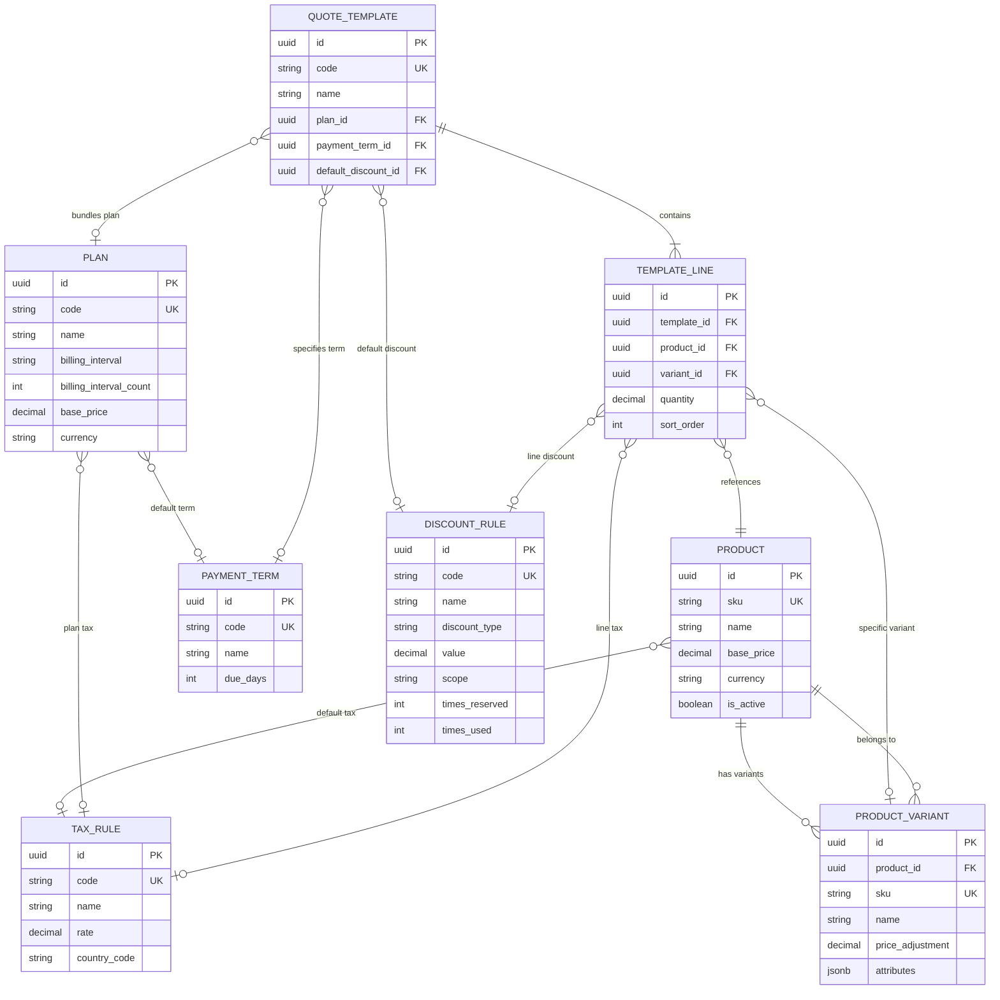
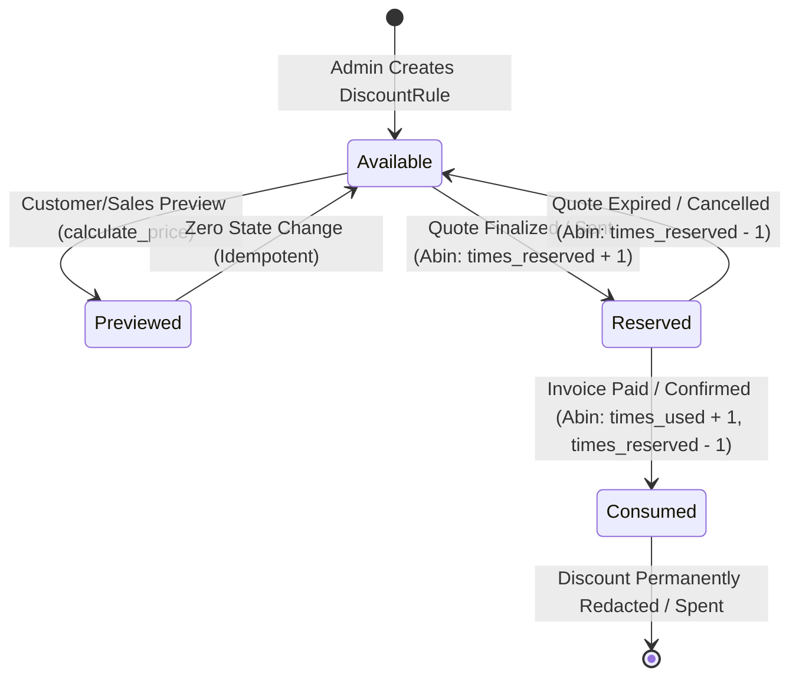

# Architecture & Data Contract: Catalog & Authoritative Pricing Engine

| Metadata | Value |
| :--- | :--- |
| **Document Version** | 1.0.0-draft |
| **Phase / Milestone** | Hour 1 – Catalog and Pricing Model Contract |
| **Author** | Aby John (Catalog, Pricing, & Products Lead) |
| **Target Tech Stack** | Python, Django 4.2.30, Django REST Framework 3.16.1, PostgreSQL, psycopg 3.2.9, Celery 5.5.3, Redis 5.2.1 |
| **Scope** | `Product`, `ProductVariant`, `Plan`, `PaymentTerm`, `TaxRule`, `DiscountRule`, `QuoteTemplate`, `TemplateLine`, `calculate_price(...)` service, `POST /api/v1/pricing/preview` API |
| **Status** | Contract Proposed – Awaiting Team Review (Rijin, Abin, Adithyan) |

---

## 1. Executive Summary & Architectural Positioning

This contract establishes the domain model structures, data types, constraints, and mathematical rules governing the **Catalog** and **Authoritative Pricing Engine** for the Subscription Management System.

In modern multi-tier recurring billing systems, inconsistent price calculation across quotation drafting, customer checkout, recurring billing, and mid-cycle proration is a primary cause of financial leakage and customer disputes. To guarantee absolute mathematical consistency and auditability, this architecture adopts the **Single Authoritative Pricing Engine** pattern:
- The pricing engine (`calculate_price`) is an isolated, deterministic, side-effect-free pure domain service.
- Quotation preview, quotation issuance, subscription recurring invoicing, and ad-hoc billing **all execute the exact same pricing logic**.
- All currency computations enforce Python standard library `Decimal` with fixed 2-place banker's rounding (`ROUND_HALF_UP`) to prevent IEEE 754 floating-point inaccuracies.
- Pricing previews are read-only: **no discount allocations, usage limits, or reservations are mutated during a preview**.

---

## 2. Django Application Structure & Model Ownership

The backend repository organizes responsibilities across discrete Django applications. The table below specifies model ownership, table names, and app boundaries:

| Model | Owning Django App | Target Database Table | Primary Responsibility |
| :--- | :--- | :--- | :--- |
| **`Product`** | `products` | `products_product` | Base catalog product/service definitions and default sales prices. |
| **`ProductVariant`** | `products` | `products_productvariant` | SKU variations of a product with additive price adjustments. |
| **`TaxRule`** | `products` *(or `billing`)* | `products_taxrule` | Tax jurisdictions, additive percentage rates, and application rules. |
| **`Plan`** | `plans` | `plans_plan` | Recurring billing plan contracts, cycle intervals, and base periodic fees. |
| **`PaymentTerm`** | `plans` *(or `billing`)* | `plans_paymentterm` | Commercial payment terms (Net 15, Net 30, Due on Receipt). |
| **`DiscountRule`** | `discounts` | `discounts_discountrule` | Discount specifications (percentage/fixed), validity rules, and usage counters. |
| **`QuoteTemplate`** | `quotations` | `quotations_quotetemplate` | Standardized quotation packages bundling plans, terms, and default items. |
| **`TemplateLine`** | `quotations` | `quotations_templateline` | Pre-defined line item associations belonging to a `QuoteTemplate`. |

---

## 3. Data Model Specifications

All monetary fields are defined as `DecimalField(max_digits=12, decimal_places=2)` unless specified otherwise. All primary keys use `UUIDField(default=uuid.uuid4, editable=False, primary_key=True)` to ensure distributed safety and avoid sequential ID enumeration.

### 3.1. `Product` Model (`products` app)

Represents a base sellable good, service, or recurring add-on.

```text
Table: products_product
```

| Field Name | Type | Null / Blank | Default | Constraints / Validation | Description |
| :--- | :--- | :--- | :--- | :--- | :--- |
| `id` | `UUIDField` | `False / False` | `uuid4` | PK | Globally unique identifier. |
| `sku` | `CharField(max_length=64)` | `False / False` | None | `unique=True`, indexed | Stock Keeping Unit code (e.g., `PROD-STORAGE-ADDON`). |
| `name` | `CharField(max_length=255)` | `False / False` | None | Indexed | Human-readable product name. |
| `description` | `TextField` | `True / True` | `""` | None | Detailed specifications or marketing copy. |
| `product_type` | `CharField(max_length=32)` | `False / False` | `'service'` | Choices: `service`, `consumable`, `addon` | Classification for fulfillment and invoice categorization. |
| `base_price` | `DecimalField(12, 2)` | `False / False` | `Decimal('0.00')` | `MinValueValidator(Decimal('0.00'))` | Default baseline selling price before variant adjustments. |
| `currency` | `CharField(max_length=3)` | `False / False` | `'INR'` | ISO 4217 code (3 chars) | Default catalog pricing currency. |
| `tax_rule` | `ForeignKey('TaxRule')` | `True / True` | `None` | `on_delete=models.SET_NULL` | Default tax rule applicable to this product. |
| `is_active` | `BooleanField` | `False / False` | `True` | Indexed | Soft availability toggle for catalog selectors. |
| `created_at` | `DateTimeField` | `False / False` | `auto_now_add` | Immutable | Record creation timestamp. |
| `updated_at` | `DateTimeField` | `False / False` | `auto_now` | Auto-updated | Record modification timestamp. |

---

### 3.2. `ProductVariant` Model (`products` app)

Represents a concrete variation of a base product (e.g., storage capacity, SLA level, region).

```text
Table: products_productvariant
```

| Field Name | Type | Null / Blank | Default | Constraints / Validation | Description |
| :--- | :--- | :--- | :--- | :--- | :--- |
| `id` | `UUIDField` | `False / False` | `uuid4` | PK | Globally unique identifier. |
| `product` | `ForeignKey('Product')` | `False / False` | None | `on_delete=models.CASCADE`, `related_name='variants'` | Parent product reference. |
| `sku` | `CharField(max_length=64)` | `False / False` | None | `unique=True`, indexed | Variant-level SKU (e.g., `PROD-STORAGE-500GB`). |
| `name` | `CharField(max_length=255)` | `False / False` | None | None | Variant name (e.g., "500GB SSD Storage Tier"). |
| `price_adjustment` | `DecimalField(12, 2)` | `False / False` | `Decimal('0.00')` | None (can be positive, zero, or negative) | Amount added to `Product.base_price`. |
| `attributes` | `JSONField` | `False / False` | `dict` | Schema validation for key/value pairs | Structured attribute metadata (e.g., `{"storage": "500GB", "tier": "ssd"}`). |
| `is_active` | `BooleanField` | `False / False` | `True` | Indexed | Soft availability toggle. |
| `created_at` | `DateTimeField` | `False / False` | `auto_now_add` | Immutable | Creation timestamp. |
| `updated_at` | `DateTimeField` | `False / False` | `auto_now` | Auto-updated | Modification timestamp. |

> **Business Rule:**
> $$\text{Variant Unit Price} = \text{Product.base\_price} + \text{ProductVariant.price\_adjustment}$$
> A database check constraint enforces $\text{Variant Unit Price} \ge 0.00$.

---

### 3.3. `Plan` Model (`plans` app)

Represents a recurring subscription plan template dictating cadence and baseline membership fee.

```text
Table: plans_plan
```

| Field Name | Type | Null / Blank | Default | Constraints / Validation | Description |
| :--- | :--- | :--- | :--- | :--- | :--- |
| `id` | `UUIDField` | `False / False` | `uuid4` | PK | Globally unique identifier. |
| `code` | `SlugField(max_length=64)` | `False / False` | None | `unique=True`, indexed | Unique system slug (e.g., `enterprise-annual-v1`). |
| `name` | `CharField(max_length=255)` | `False / False` | None | None | Marketing name (e.g., "Enterprise Cloud Suite"). |
| `description` | `TextField` | `True / True` | `""` | None | Detailed plan deliverables. |
| `billing_interval` | `CharField(max_length=16)` | `False / False` | `'monthly'` | Choices: `daily`, `weekly`, `monthly`, `quarterly`, `yearly` | Billing frequency unit. |
| `billing_interval_count` | `PositiveIntegerField` | `False / False` | `1` | `MinValueValidator(1)` | Multiplier (e.g., 3 with `monthly` = quarterly). |
| `base_price` | `DecimalField(12, 2)` | `False / False` | `Decimal('0.00')` | `MinValueValidator(Decimal('0.00'))` | Flat periodic base fee per billing cycle. |
| `currency` | `CharField(max_length=3)` | `False / False` | `'INR'` | ISO 4217 code (3 chars) | Billing currency. |
| `trial_period_days` | `PositiveIntegerField` | `False / False` | `0` | `MinValueValidator(0)` | Free trial days before initial invoice generation. |
| `tax_rule` | `ForeignKey('TaxRule')` | `True / True` | `None` | `on_delete=models.SET_NULL` | Default tax rule applied to the plan base fee. |
| `payment_term` | `ForeignKey('PaymentTerm')`| `True / True` | `None` | `on_delete=models.PROTECT` | Default payment terms for generated subscription invoices. |
| `is_active` | `BooleanField` | `False / False` | `True` | Indexed | Whether plan is open for new subscriptions. |
| `created_at` | `DateTimeField` | `False / False` | `auto_now_add` | Immutable | Creation timestamp. |
| `updated_at` | `DateTimeField` | `False / False` | `auto_now` | Auto-updated | Modification timestamp. |

---

### 3.4. `PaymentTerm` Model (`plans` app or `billing` app)

Defines commercial payment windows and due date rules for quotations and invoices.

```text
Table: plans_paymentterm
```

| Field Name | Type | Null / Blank | Default | Constraints / Validation | Description |
| :--- | :--- | :--- | :--- | :--- | :--- |
| `id` | `UUIDField` | `False / False` | `uuid4` | PK | Globally unique identifier. |
| `code` | `SlugField(max_length=32)` | `False / False` | None | `unique=True`, indexed | Lookup code (e.g., `immediate`, `net-15`, `net-30`). |
| `name` | `CharField(max_length=128)` | `False / False` | None | None | Display title (e.g., "Net 30 Days"). |
| `due_days` | `PositiveIntegerField` | `False / False` | `0` | `MinValueValidator(0)` | Calendar days added to invoice date to determine `due_date`. |
| `description` | `TextField` | `True / True` | `""` | None | Detailed terms printed on quotations and invoices. |
| `is_active` | `BooleanField` | `False / False` | `True` | Indexed | Availability toggle. |
| `created_at` | `DateTimeField` | `False / False` | `auto_now_add` | Immutable | Creation timestamp. |
| `updated_at` | `DateTimeField` | `False / False` | `auto_now` | Auto-updated | Modification timestamp. |

---

### 3.5. `TaxRule` Model (`products` app or `billing` app)

Defines exclusive additive percentage taxes applied to taxable line amounts after discounts.

```text
Table: products_taxrule
```

| Field Name | Type | Null / Blank | Default | Constraints / Validation | Description |
| :--- | :--- | :--- | :--- | :--- | :--- |
| `id` | `UUIDField` | `False / False` | `uuid4` | PK | Globally unique identifier. |
| `code` | `SlugField(max_length=32)` | `False / False` | None | `unique=True`, indexed | Tax code (e.g., `gst-18`, `vat-standard-20`). |
| `name` | `CharField(max_length=128)` | `False / False` | None | None | Human-readable name (e.g., "GST 18%"). |
| `rate` | `DecimalField(5, 2)` | `False / False` | `Decimal('0.00')` | `MinValueValidator(Decimal('0.00'))`, `MaxValueValidator(Decimal('100.00'))` | Percentage tax rate (e.g. `18.00` represents 18%). |
| `country_code` | `CharField(max_length=2)` | `True / True` | `""` | ISO 3166-1 alpha-2 (e.g., `'IN'`) | Jurisdiction country targeting. |
| `is_active` | `BooleanField` | `False / False` | `True` | Indexed | Availability toggle. |
| `created_at` | `DateTimeField` | `False / False` | `auto_now_add` | Immutable | Creation timestamp. |
| `updated_at` | `DateTimeField` | `False / False` | `auto_now` | Auto-updated | Modification timestamp. |

> **Policy Enforcement:** Taxes are **tax-exclusive** and calculated **after discounts**.

---

### 3.6. `DiscountRule` Model (`discounts` app)

Defines promo codes, volume discounts, and quote-level discount configurations with consumption controls.

```text
Table: discounts_discountrule
```

| Field Name | Type | Null / Blank | Default | Constraints / Validation | Description |
| :--- | :--- | :--- | :--- | :--- | :--- |
| `id` | `UUIDField` | `False / False` | `uuid4` | PK | Globally unique identifier. |
| `code` | `CharField(max_length=64)` | `True / True` | `None` | `unique=True`, indexed (case-insensitive) | Coupon code entered by user; `None` for automatic rules. |
| `name` | `CharField(max_length=255)` | `False / False` | None | None | Friendly rule title (e.g., "Startup Partner 10% Off"). |
| `discount_type` | `CharField(max_length=16)` | `False / False` | `'percentage'` | Choices: `percentage`, `fixed_amount` | Nature of deduction. |
| `value` | `DecimalField(12, 2)` | `False / False` | `Decimal('0.00')` | `MinValueValidator(Decimal('0.00'))` | Deduction value (e.g., `10.00` for 10% or `500.00` for ₹500). |
| `scope` | `CharField(max_length=16)` | `False / False` | `'order'` | Choices: `order`, `plan`, `lines` | Target of the discount allocation. |
| `min_order_amount` | `DecimalField(12, 2)` | `True / True` | `None` | `MinValueValidator(Decimal('0.00'))` | Minimum gross subtotal required for rule eligibility. |
| `max_discount_cap`| `DecimalField(12, 2)` | `True / True` | `None` | Optional ceiling for percentage discounts. |
| `valid_from` | `DateTimeField` | `False / False` | `timezone.now` | Must be $\le$ `valid_to` | Start date and time of validity window. |
| `valid_to` | `DateTimeField` | `True / True` | `None` | Optional expiry timestamp. |
| `max_uses` | `PositiveIntegerField` | `True / True` | `None` | Max cumulative redemptions permitted across system. |
| `times_reserved` | `PositiveIntegerField` | `False / False` | `0` | Soft locked count across pending quotes. |
| `times_used` | `PositiveIntegerField` | `False / False` | `0` | Committed redemption count on finalized invoices. |
| `is_active` | `BooleanField` | `False / False` | `True` | Indexed | Administrative master switch. |
| `created_at` | `DateTimeField` | `False / False` | `auto_now_add` | Immutable | Creation timestamp. |
| `updated_at` | `DateTimeField` | `False / False` | `auto_now` | Auto-updated | Modification timestamp. |

---

### 3.7. `QuoteTemplate` Model (`quotations` app)

Predefined quotation blueprints enabling 1-click generation of complex bundled subscription quotations.

```text
Table: quotations_quotetemplate
```

| Field Name | Type | Null / Blank | Default | Constraints / Validation | Description |
| :--- | :--- | :--- | :--- | :--- | :--- |
| `id` | `UUIDField` | `False / False` | `uuid4` | PK | Globally unique identifier. |
| `code` | `SlugField(max_length=64)` | `False / False` | None | `unique=True`, indexed | Template identifier slug (e.g., `standard-saas-pkg`). |
| `name` | `CharField(max_length=255)` | `False / False` | None | None | Display title in quotation builder. |
| `description` | `TextField` | `True / True` | `""` | None | Internal guidance or summary. |
| `plan` | `ForeignKey('plans.Plan')` | `True / True` | `None` | `on_delete=models.SET_NULL` | Pre-selected subscription plan. |
| `payment_term` | `ForeignKey('plans.PaymentTerm')` | `True / True` | `None` | `on_delete=models.SET_NULL` | Default payment term associated with template. |
| `default_discount`| `ForeignKey('discounts.DiscountRule')` | `True / True` | `None` | `on_delete=models.SET_NULL` | Pre-applied discount rule if eligible. |
| `terms_and_conditions` | `TextField` | `True / True` | `""` | None | Legal boilerplates printed on PDF quotation. |
| `is_active` | `BooleanField` | `False / False` | `True` | Indexed | Availability switch for sales staff. |
| `created_at` | `DateTimeField` | `False / False` | `auto_now_add` | Immutable | Creation timestamp. |
| `updated_at` | `DateTimeField` | `False / False` | `auto_now` | Auto-updated | Modification timestamp. |

---

### 3.8. `TemplateLine` Model (`quotations` app)

Specific product line items configured inside a `QuoteTemplate`.

```text
Table: quotations_templateline
```

| Field Name | Type | Null / Blank | Default | Constraints / Validation | Description |
| :--- | :--- | :--- | :--- | :--- | :--- |
| `id` | `UUIDField` | `False / False` | `uuid4` | PK | Globally unique identifier. |
| `template` | `ForeignKey('QuoteTemplate')` | `False / False` | None | `on_delete=models.CASCADE`, `related_name='lines'` | Parent quotation template. |
| `product` | `ForeignKey('products.Product')` | `False / False` | None | `on_delete=models.PROTECT` | Catalog product reference. |
| `variant` | `ForeignKey('products.ProductVariant')` | `True / True` | `None` | `on_delete=models.PROTECT` | Specific product variant (optional). |
| `quantity` | `DecimalField(10, 2)` | `False / False` | `Decimal('1.00')` | `MinValueValidator(Decimal('0.01'))` | Default line item quantity. |
| `unit_price_override` | `DecimalField(12, 2)` | `True / True` | `None` | Optional price override overriding catalog pricing. |
| `discount_rule` | `ForeignKey('discounts.DiscountRule')` | `True / True` | `None` | `on_delete=models.SET_NULL` | Pre-attached line-level discount rule. |
| `tax_rule` | `ForeignKey('products.TaxRule')` | `True / True` | `None` | `on_delete=models.SET_NULL` | Line tax rule (defaults to product tax rule if null). |
| `sort_order` | `PositiveIntegerField` | `False / False` | `0` | None | Visual sequence in line editor and PDF outputs. |
| `created_at` | `DateTimeField` | `False / False` | `auto_now_add` | Immutable | Creation timestamp. |
| `updated_at` | `DateTimeField` | `False / False` | `auto_now` | Auto-updated | Modification timestamp. |

---

## 4. Entity-Relationship (ER) Architecture

The entity relationships connecting Catalog, Plans, Discounts, and Quotation Templates are mapped in the diagram below:



---

## 5. Core Pricing Policies & Mathematical Principles

The Authoritative Pricing Engine strictly adheres to the following agreed domain rules:

1. **Variant Unit Price Rule:**
   $$\text{Variant Unit Price} = \text{Product.base\_price} + \text{ProductVariant.price\_adjustment}$$
   When no variant is specified, the unit price equals `Product.base_price`.

2. **Plan Base Fee Independence:**
   A `Plan` contributes exactly **one base fee per billing cycle**. Product line items represent add-ons or usage quantities that are strictly additive to the plan base fee. A quote or invoice may have:
   - A plan fee + zero or more product lines, OR
   - Zero plan fee (plan is null) + one or more product lines (stand-alone items).

3. **Tax-Exclusive & Additive Taxes:**
   All product catalog prices and plan fees are quoted **exclusive of taxes**.
   Taxes are percentage-based and additive:
   $$\text{Tax Amount} = \text{Taxable Net Amount} \times \left(\frac{\text{Tax Rate}}{100}\right)$$

4. **Tax Calculated Post-Discount:**
   Taxes are computed **strictly on the net discounted amount**, never on the gross amount:
   $$\text{Taxable Net Amount} = \text{Gross Amount} - \text{Discount Amount}$$
   $$\text{Tax Amount} = \text{Taxable Net Amount} \times \left(\frac{\text{Tax Rate}}{100}\right)$$

5. **Arbitrary-Precision Decimal Rule:**
   Binary floating-point arithmetic (`float`) is strictly prohibited in any calculation, serializer, or intermediate variable. All calculations use Python `decimal.Decimal` with explicit rounding using `ROUND_HALF_UP` to two decimal places at line boundaries:
   ```python
   from decimal import Decimal, ROUND_HALF_UP

   def quantize_money(amount: Decimal) -> Decimal:
       return amount.quantize(Decimal('0.01'), rounding=ROUND_HALF_UP)
   ```

6. **Strictly Idempotent & Read-Only Previews:**
   Pricing previews executed through `calculate_price` or `POST /api/v1/pricing/preview` **must never mutate the database**. They validate discount conditions (expiration, minimum spend, max uses), but **do not increment `times_reserved` or `times_used`**.

7. **Universal Engine Reusability:**
   Quotation generation (Rijin/Abin), Quotation previews, Subscription recurring generation (Celery Beat / Abin), and manual Invoice creation (Billing / Abin) invoke this exact same engine. No billing subsystem may maintain private pricing calculations.

---

## 6. Internal Pricing Service Contract (`calculate_price`)

### 6.1. Function Signature

```python
from decimal import Decimal
from datetime import date
from typing import Optional, List, Dict, Any

def calculate_price(
    plan: Optional[Any],               # Plan instance or None
    lines: List[Dict[str, Any]],       # List of item inputs
    customer: Optional[Any] = None,    # Customer instance or None
    effective_date: Optional[date] = None, # Evaluation date (defaults to today)
    order_discount: Optional[Any] = None   # Order-level DiscountRule or code
) -> Dict[str, Any]:
    """
    Authoritative pure pricing engine. Evaluates plan base fee, calculates
    line gross prices, allocates discounts, applies post-discount additive taxes,
    and returns an audited financial breakdown.
    
    Zero side-effects: Does not mutate database records or consume quotas.
    """
```

### 6.2. Input Parameters

- `plan`: A `Plan` model instance or `None`. If provided, its `base_price` is assessed as an authoritative line item for the billing cycle.
- `lines`: A list of dictionaries representing product lines. Each dictionary contains:
  - `product`: `Product` instance (required)
  - `variant`: `ProductVariant` instance (optional, defaults to `None`)
  - `quantity`: `Decimal` or `int` (required, must be $> 0$)
  - `unit_price_override`: `Optional[Decimal]` (optional manual override)
  - `tax_rule`: `Optional[TaxRule]` (falls back to `product.tax_rule`)
  - `discount_rule`: `Optional[DiscountRule]` (line-specific discount)
- `customer`: `Customer` instance or `None` (used for customer-specific discount eligibility and tax exemption flags).
- `effective_date`: `datetime.date` (defaults to current date for discount validity checking).
- `order_discount`: `DiscountRule` instance or `None` (order-level coupon/discount).

### 6.3. Execution Algorithm (Pseudo-Code)

```text
ALGORITHM calculate_price:
1. Initialize effective_date = effective_date or date.today()
2. Currency = plan.currency if plan else (lines[0].product.currency if lines else 'INR')

3. Process Plan Base Fee:
   IF plan IS NOT NULL:
       plan_gross = quantize_money(plan.base_price)
       plan_tax_rule = plan.tax_rule
   ELSE:
       plan_gross = 0.00
       plan_tax_rule = None

4. Process Product Line Items:
   FOR each item IN lines:
       IF item.unit_price_override IS NOT NULL:
           unit_price = quantize_money(item.unit_price_override)
       ELSE:
           variant_adj = item.variant.price_adjustment IF item.variant ELSE 0.00
           unit_price = quantize_money(item.product.base_price + variant_adj)
       
       line_gross = quantize_money(unit_price * Decimal(item.quantity))
       store line_gross

5. Compute Subtotal:
   subtotal = quantize_money(plan_gross + SUM(all line_gross))

6. Discount Evaluation & Allocation:
   a. Evaluate Line-Level Discounts:
      FOR each line:
          line_discount = evaluate_discount(line.discount_rule, target_gross=line_gross)
          line_net = line_gross - line_discount
   
   b. Evaluate Plan-Level Discounts:
      plan_discount = evaluate_discount(plan_discount_rule, target_gross=plan_gross)
      plan_net = plan_gross - plan_discount

   c. Evaluate Order-Level Discount:
      IF order_discount IS VALID:
          order_discount_amt = evaluate_discount(order_discount, target_gross=subtotal)
          Pro-rate order_discount_amt across remaining net line amounts proportionally
   
   total_discount = SUM(all discount allocations)

7. Tax Evaluation (Post-Discount):
   FOR each entity (plan and lines):
       net_taxable_amount = entity.net_amount
       tax_rule = entity.tax_rule
       IF tax_rule IS NOT NULL:
           entity_tax = quantize_money(net_taxable_amount * (tax_rule.rate / 100))
       ELSE:
           entity_tax = 0.00
   
   total_tax = SUM(all entity taxes)

8. Compute Final Totals:
   final_total = quantize_money(subtotal - total_discount + total_tax)

9. Return Output Structure
```

### 6.4. Output Data Structure

The engine returns a structured dictionary matching this contract:

```python
{
    "currency": "INR",
    "plan_summary": {
        "plan_id": "9b1deb4d-3b7d-4bad-9bdd-2b0d7b3dcb6d",
        "plan_code": "enterprise-monthly",
        "plan_name": "Enterprise Monthly Plan",
        "base_fee": Decimal("1000.00"),
        "discount_amount": Decimal("0.00"),
        "net_amount": Decimal("1000.00"),
        "tax_rate": Decimal("18.00"),
        "tax_amount": Decimal("180.00"),
        "total_amount": Decimal("1180.00")
    },
    "lines": [
        {
            "line_index": 0,
            "product_id": "4a7b7a1e-8e3b-48c5-b827-0435c24d1a11",
            "product_sku": "PROD-STORAGE",
            "product_name": "High Performance Cloud Storage",
            "variant_id": "7f8c9b2a-1c3d-4e5f-a6b7-8c9d0e1f2a3b",
            "variant_sku": "PROD-STORAGE-500GB",
            "variant_name": "500GB SSD Storage Tier",
            "quantity": Decimal("10.00"),
            "unit_base_price": Decimal("2000.00"),
            "variant_adjustment": Decimal("560.00"),
            "effective_unit_price": Decimal("2560.00"),
            "gross_amount": Decimal("25600.00"),
            "discount_rule_id": "f3b2a1c0-4d5e-6f7a-8b9c-0d1e2f3a4b5c",
            "discount_code": "PROMO10",
            "discount_amount": Decimal("2560.00"),
            "net_amount": Decimal("23040.00"),
            "tax_rule_id": "e2a1b0c9-3d4e-5f6a-7b8c-9d0e1f2a3b4c",
            "tax_rule_code": "gst-18",
            "tax_rate": Decimal("18.00"),
            "tax_amount": Decimal("4147.20"),
            "total_amount": Decimal("27187.20")
        }
    ],
    "subtotal": Decimal("26600.00"),       # 1000.00 (plan) + 25600.00 (lines)
    "total_discount": Decimal("2560.00"),  # Total discount
    "total_tax": Decimal("4327.20"),       # 180.00 (plan tax) + 4147.20 (line tax)
    "final_total": Decimal("28367.20")     # 26600.00 - 2560.00 + 4327.20
}
```

---

## 7. Pricing Preview REST API Contract

### 7.1. Endpoint Definition

```http
POST /api/v1/pricing/preview
Content-Type: application/json
Accept: application/json
```

- **Authentication:** Token / Session / JWT (authenticated sales agents or portal clients).
- **Behavior:** Pure preview. Strictly read-only; no database writes; no coupon redemptions.

### 7.2. Request Payload Schema

```json
{
  "plan_id": "9b1deb4d-3b7d-4bad-9bdd-2b0d7b3dcb6d",
  "coupon_code": "PROMO10",
  "customer_id": "2c9d8e7f-6a5b-4c3d-2e1f-0a9b8c7d6e5f",
  "effective_date": "2026-10-31",
  "lines": [
    {
      "product_id": "4a7b7a1e-8e3b-48c5-b827-0435c24d1a11",
      "variant_id": "7f8c9b2a-1c3d-4e5f-a6b7-8c9d0e1f2a3b",
      "quantity": "10.00",
      "unit_price_override": null,
      "discount_code": null,
      "tax_rule_id": null
    }
  ]
}
```

#### Field Specifications:

| Field | Type | Required | Description |
| :--- | :--- | :--- | :--- |
| `plan_id` | `UUID` | Optional | Target subscription plan ID (if quote includes recurring membership). |
| `coupon_code`| `String` | Optional | Order-level promotional code. |
| `customer_id`| `UUID` | Optional | Customer context for tax exemption and tier discount checking. |
| `effective_date` | `String (YYYY-MM-DD)` | Optional | Evaluation date (defaults to current server date). |
| `lines` | `Array[Object]` | Required | List of product items to be quoted/purchased (min length 0 if plan provided, else min 1). |
| `lines[].product_id` | `UUID` | Required | Catalog product ID. |
| `lines[].variant_id` | `UUID` | Optional | Specific variant ID. |
| `lines[].quantity` | `Decimal string` | Required | Quantity requested ($\ge 0.01$). |
| `lines[].unit_price_override` | `Decimal string` | Optional | Manual price override granted by sales rep. |
| `lines[].discount_code` | `String` | Optional | Line-specific coupon code. |
| `lines[].tax_rule_id` | `UUID` | Optional | Override tax rule ID. |

### 7.3. Success Response (`200 OK`)

```json
{
  "status": "success",
  "data": {
    "currency": "INR",
    "effective_date": "2026-10-31",
    "plan": {
      "id": "9b1deb4d-3b7d-4bad-9bdd-2b0d7b3dcb6d",
      "code": "enterprise-monthly",
      "name": "Enterprise Monthly Plan",
      "base_fee": "1000.00",
      "discount_amount": "0.00",
      "net_amount": "1000.00",
      "tax_rate": "18.00",
      "tax_amount": "180.00",
      "total_amount": "1180.00"
    },
    "lines": [
      {
        "line_index": 0,
        "product_id": "4a7b7a1e-8e3b-48c5-b827-0435c24d1a11",
        "product_sku": "PROD-STORAGE",
        "product_name": "High Performance Cloud Storage",
        "variant_id": "7f8c9b2a-1c3d-4e5f-a6b7-8c9d0e1f2a3b",
        "variant_sku": "PROD-STORAGE-500GB",
        "variant_name": "500GB SSD Storage Tier",
        "quantity": "10.00",
        "unit_base_price": "2000.00",
        "variant_adjustment": "560.00",
        "effective_unit_price": "2560.00",
        "gross_amount": "25600.00",
        "discount_rule_id": "f3b2a1c0-4d5e-6f7a-8b9c-0d1e2f3a4b5c",
        "discount_code": "PROMO10",
        "discount_amount": "2560.00",
        "net_amount": "23040.00",
        "tax_rule_id": "e2a1b0c9-3d4e-5f6a-7b8c-9d0e1f2a3b4c",
        "tax_rule_code": "gst-18",
        "tax_rate": "18.00",
        "tax_amount": "4147.20",
        "total_amount": "27187.20"
      }
    ],
    "subtotal": "26600.00",
    "total_discount": "2560.00",
    "total_tax": "4327.20",
    "final_total": "28367.20"
  }
}
```

### 7.4. Error Responses

- **`400 Bad Request`**: Validation failure (e.g. invalid UUID format, negative quantities, missing required fields).
- **`404 Not Found`**: Referenced `product_id`, `variant_id`, `plan_id`, or `customer_id` does not exist or is inactive.
- **`422 Unprocessable Entity`**: Business policy conflict (e.g., variant does not belong to specified product, coupon expired or minimum spend not met).

```json
{
  "status": "error",
  "code": "COUPON_EXPIRED",
  "message": "The promotional coupon code 'EXPIRED20' expired on 2026-10-15.",
  "details": {
    "coupon_code": "EXPIRED20",
    "valid_to": "2026-10-15T23:59:59Z",
    "effective_date": "2026-10-31"
  }
}
```

---

## 8. Illustrative Example Calculation

> [!IMPORTANT]
> **DISCLAIMER:** The values, prices, discounts, and tax rates below are **purely illustrative test data** used to demonstrate mathematical correctness, rounding rules, and pricing policies. They do **NOT** represent hardcoded system constants.

### 8.1. Given Input Parameters

- **Product Base Price:** ₹2,000.00
- **Variant Price Adjustment:** ₹560.00
- **Quantity:** 10
- **Discount:** 10% (percentage-based discount)
- **Tax Rule:** 18% (additive percentage tax, tax-exclusive, post-discount)

---

### 8.2. Mathematical Breakdown (Line-Item Level)

#### Step 1: Compute Effective Unit Price
Applying the Variant Price Policy:
$$\text{Effective Unit Price} = \text{Product Base Price} + \text{Variant Adjustment}$$
$$\text{Effective Unit Price} = ₹2,000.00 + ₹560.00 = ₹2,560.00$$

#### Step 2: Compute Line Gross Amount
$$\text{Line Gross Amount} = \text{Effective Unit Price} \times \text{Quantity}$$
$$\text{Line Gross Amount} = ₹2,560.00 \times 10 = ₹25,600.00$$

#### Step 3: Compute Discount Allocation
Applying 10% discount to Line Gross Amount:
$$\text{Discount Amount} = \text{Line Gross Amount} \times \left(\frac{10}{100}\right)$$
$$\text{Discount Amount} = ₹25,600.00 \times 0.10 = ₹2,560.00$$

#### Step 4: Compute Taxable Line Net Amount
Taxes are applied post-discount:
$$\text{Taxable Net Amount} = \text{Line Gross Amount} - \text{Discount Amount}$$
$$\text{Taxable Net Amount} = ₹25,600.00 - ₹2,560.00 = ₹23,040.00$$

#### Step 5: Compute Additive Tax Amount
Applying 18% tax-exclusive tax to Taxable Net Amount:
$$\text{Tax Amount} = \text{Taxable Net Amount} \times \left(\frac{18}{100}\right)$$
$$\text{Tax Amount} = ₹23,040.00 \times 0.18 = ₹4,147.20$$

#### Step 6: Compute Line Final Total
$$\text{Line Total} = \text{Taxable Net Amount} + \text{Tax Amount}$$
$$\text{Line Total} = ₹23,040.00 + ₹4,147.20 = ₹27,187.20$$

---

### 8.3. Comparison Summary Table

#### Scenario A: Stand-alone Product Line (No Plan Base Fee)

| Calculation Component | Formula | Amount (INR) |
| :--- | :--- | :--- |
| Product Base Price | Catalog baseline | ₹2,000.00 |
| Variant Adjustment | Variant additive differential | + ₹560.00 |
| **Effective Unit Price** | $\text{Base} + \text{Adjustment}$ | **₹2,560.00** |
| Quantity | Units purchased | 10 |
| **Line Gross Amount (Subtotal)** | $\text{Unit Price} \times \text{Quantity}$ | **₹25,600.00** |
| **Total Discount (10%)** | $₹25,600.00 \times 10\%$ | **- ₹2,560.00** |
| **Net Taxable Subtotal** | $\text{Gross} - \text{Discount}$ | **₹23,040.00** |
| **Total Tax (18% post-discount)**| $₹23,040.00 \times 18\%$ | **+ ₹4,147.20** |
| **Final Total** | $\text{Net} + \text{Tax}$ | **₹27,187.20** |

#### Scenario B: Plan Base Fee + Product Line Item
Demonstrating policy: *"Plan price is one base fee per billing cycle. Product charges are additional to the plan base fee."*
Assuming illustrative Plan Base Fee = ₹1,000.00/month with 18% tax (₹180.00):

| Component | Gross | Discount | Net Taxable | Tax (18%) | Total |
| :--- | :--- | :--- | :--- | :--- | :--- |
| **Plan Base Fee (1 Cycle)** | ₹1,000.00 | ₹0.00 | ₹1,000.00 | ₹180.00 | ₹1,180.00 |
| **Product Line (10 Units)** | ₹25,600.00 | ₹2,560.00 | ₹23,040.00 | ₹4,147.20 | ₹27,187.20 |
| **ORDER TOTAL** | **₹26,600.00** | **₹2,560.00** | **₹24,040.00** | **₹4,327.20** | **₹28,367.20** |

---

## 9. Discount Reservation, Consumption & Release Lifecycle

To maintain transaction integrity across asynchronous workflows (quotation drafting $\rightarrow$ approval $\rightarrow$ invoice generation $\rightarrow$ payment), the team coordinates discount state management across two clear spheres of responsibility:



### 9.1. Division of Responsibility Matrix

| Responsibility Scope | Aby (Catalog & Pricing Lead) | Abin (Quotations, Billing & Subscriptions Lead) |
| :--- | :--- | :--- |
| **Eligibility Validation** | Validates rule expiration (`valid_from`/`valid_to`), active status, minimum spend, customer scope, and available quota $(\text{times\_used} + \text{times\_reserved} < \text{max\_uses})$. | Passes customer and quote context into `calculate_price`. |
| **Pricing Preview** | Strictly read-only calculation. Zero state mutation. Does **not** increment any counters. | Calls `POST /api/v1/pricing/preview` to render dynamic totals on the frontend quote builder. |
| **Discount Reservation** | Provides domain method `DiscountService.reserve(rule, quote_id)`. | Calls reservation upon transitioning quotation to `SENT` or `PENDING_APPROVAL`. Enforces TTL on reservations. |
| **Discount Consumption** | Provides domain method `DiscountService.consume(rule, quote_id)`. | Calls consumption when quotation is `ACCEPTED` and initial subscription `Invoice` is transitioned to `PAID`. |
| **Discount Release** | Provides domain method `DiscountService.release(rule, quote_id)`. | Triggers release when quote expires, is rejected, or is cancelled by customer/sales. |
| **Audit Trails & Concurrency**| Designs atomic database updates (`F()` expressions) and row-level locks (`SELECT FOR UPDATE`). | Wraps quote finalization and invoice payment in `transaction.atomic()`. |

### 9.2. Concurrency & Double-Spend Mitigation Strategy

To prevent race conditions where multiple users simultaneously redeem a strictly capped discount code (e.g., "First 50 subscribers get 50% off"):
1. The pricing engine checks availability using:
   $$\text{Available Redemptions} = \text{max\_uses} - (\text{times\_used} + \text{times\_reserved}) > 0$$
2. When Abin's workflow reserves or consumes the discount, it executes an atomic condition inside `transaction.atomic()`:
   ```python
   # Atomic reservation pattern
   rows_updated = DiscountRule.objects.filter(
       id=discount_id,
       is_active=True
   ).filter(
       models.Q(max_uses__isnull=True) |
       models.Q(times_used + times_reserved__lt=models.F('max_uses'))
   ).update(
       times_reserved=models.F('times_reserved') + 1
   )

   if rows_updated == 0:
       raise DiscountQuotaExhaustedError("Discount quota has just been exhausted.")
   ```

---

## 10. Cross-Developer Integration Contracts

### 10.1. Integration with Rijin Reji (Team Lead & Full-Stack / Frontend Lead)

- **API Endpoints:**
  - `GET /api/v1/products/` and `GET /api/v1/products/{id}/variants/` for product catalogs.
  - `GET /api/v1/plans/` for subscription plan selection.
  - `POST /api/v1/pricing/preview` for reactive calculation during quote building.
- **Frontend State Integration:**
  - Whenever line item quantities, selected variants, plans, or coupon codes change in the React quotation builder, the UI debounces ($300\text{ms}$) and posts to `/api/v1/pricing/preview`.
  - The frontend renders the returned authoritative line gross, net, tax, discount, and final total amounts without executing client-side financial rounding.

### 10.2. Integration with Abin Oliver (Backend / Quotations, Subscriptions, & Billing Lead)

- **Line Item Immutability (Snapshotting):**
  When a quote is accepted and converted to a `Subscription` or `Invoice`, Abin's models (`QuoteLine`, `InvoiceLine`) **must snapshot all monetary values** generated by `calculate_price`:
  - `unit_price` (snapshotted)
  - `gross_amount` (snapshotted)
  - `discount_amount` (snapshotted)
  - `tax_amount` (snapshotted)
  - `net_amount` (snapshotted)
  - `total_amount` (snapshotted)
  *Reason:* Subsequent catalog price updates or tax rule modifications must never retroactively change historical quotations or issued legal tax invoices.
- **Shared Pricing Service Invocation:**
  Abin's invoice generation Celery tasks import `calculate_price` directly from Aby's pricing service module (e.g. `products.services.pricing` or `billing.services.pricing`).

### 10.3. Integration with Adithyan S Prathap (Backend / Customers & AI Lead)

- **Customer Tax Exemption & Currency:**
  - Customer profile models in `customers` supply tax exemption status (e.g. `is_tax_exempt = True` for government or SEZ accounts) and billing country/state for location-based `TaxRule` matching.
  - Customer tier data allows the pricing engine to evaluate VIP or partner-specific discount rules.

---

## 11. Open Questions & Decision Log for Team Alignment

Before Hour 2 implementation begins, the team should align on the following design questions:

1. **Tax Rule Hierarchy & Multi-Tax Support:**
   - *Current contract:* Single percentage tax rate per product line (e.g. GST 18%).
   - *Question for Rijin & Abin:* Does the Indian GST requirement require splitting the 18% into separate CGST (9%) and SGST (9%) line breakdowns on the invoice output, or is a single composite tax rate sufficient for the hackathon MVP?
   - *Aby's recommendation:* Store composite rate in `TaxRule` with optional sub-components in a JSON breakdown field (`{"cgst": 9.0, "sgst": 9.0}`).

2. **PaymentTerm Placement:**
   - *Question:* Should `PaymentTerm` live in `plans` app or `billing` app?
   - *Aby's recommendation:* Place in `plans` (or shared `billing`) with foreign keys from `QuoteTemplate`, `Plan`, and `Invoice`.

3. **Multi-Currency Support:**
   - *Current contract:* Default currency is `'INR'`.
   - *Question:* Are multi-currency conversions required, or will each plan/product maintain fixed amounts in their stated currency?
   - *Aby's recommendation:* Lock to `INR` for MVP with strict ISO currency code validation.

4. **Discount Rule Compounding:**
   - *Current contract:* One line-level discount + one order-level discount maximum.
   - *Question:* Should multiple discount codes be stackable?
   - *Aby's recommendation:* Do not allow stacking in MVP to avoid negative margin risks.

---

## 12. Verification & Next Steps

This document serves as the formal design freeze for Hour 1.
- No Django model files or migrations have been created in this milestone.
- In Hour 2, model implementations in `products/models.py`, `plans/models.py`, `discounts/models.py`, and `quotations/models.py` will strictly adhere to the schemas defined in Section 3.

